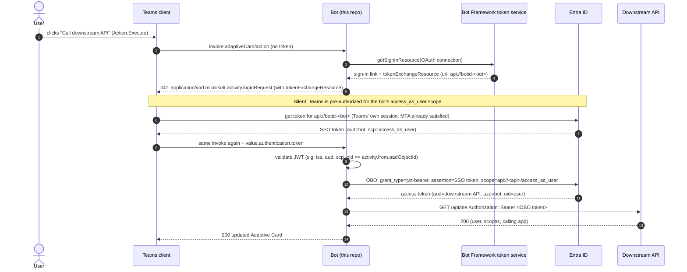

# Teams bot: Adaptive Card → silent SSO → on-behalf-of → your API

A proof of concept for this flow: a user clicks a button on an Adaptive Card in Teams, and the bot calls
**another service, protected by its own Entra ID app registration**, *as that user*. It uses the OAuth 2.0
**on-behalf-of (OBO)** flow, and the user sees **no sign-in or MFA popup**.

- **Bot:** C# / .NET 10 on the [Teams SDK for .NET](https://github.com/microsoft/teams.net) (`Microsoft.Teams.Apps` 2.1.1)
- **OBO:** [MSAL.NET](https://github.com/AzureAD/microsoft-authentication-library-for-dotnet) (`AcquireTokenOnBehalfOf`)
- **Sample downstream API:** ASP.NET Core + [Microsoft.Identity.Web](https://github.com/AzureAD/microsoft-identity-web)

```
Teams client ──(Action.Execute)──► Bot ──(OBO)──► Entra ID ──► Bot ──(Bearer user token)──► Downstream API
```

## Why your bot only had "a token with the user's name in it"

None of the tokens a bot receives by default can be used for OBO:

| What you looked at | What it really is | Usable for OBO? |
| --- | --- | --- |
| `Authorization: Bearer …` header on the POST to `/api/messages` | A **Bot Connector service token**: `iss` = `https://api.botframework.com`, `aud` = your bot's app ID. It proves *the Bot Framework* called you. It says nothing about the user. | No |
| `activity.from` (`name`, `aadObjectId`) | Identity *hints* about the user. Not a token. | No |
| A token with `name` / `preferred_username` but **no `scp` claim** | Probably an **ID token**. It describes the user to a client app. It doesn't grant access to an API. | No |
| What this POC gets: `aud` = your bot (`<bot-client-id>` or `api://botid-…`), `scp` = `access_as_user`, `azp` = a Teams client ID | A real delegated **access token for your bot's API**, issued by Entra to Teams for this user | **Yes**, this is the OBO assertion |

A bot never receives a user access token unless it **asks Teams for one**. For Adaptive Cards, the
mechanism is the **Universal Actions (`Action.Execute`) SSO handshake**. Microsoft documents it in
[Enable SSO for Adaptive Cards Universal Actions](https://learn.microsoft.com/microsoftteams/platform/task-modules-and-cards/cards/universal-actions-for-adaptive-cards/sso-adaptive-cards-universal-action).

## How it works



Steps 4–9 happen on every click, but the user never sees them. If the OBO call returns
`consent_required` or needs MFA (`AADSTS65001`, `AADSTS50076`, …), the bot replies with a sign-in request
*without* SSO info. Teams then shows a **Sign in** button (one time). After sign-in, Teams re-sends the
action with a magic code in `value.state`, which the bot redeems. If the SSO token is unusable, the bot
replies `412 preconditionFailed`, and Teams also falls back to the button.

The reusable part is [`CardActionSso`](src/Bot/Sso/CardActionSso.cs). Run any `Action.Execute` handler
through it, and the handler receives an access token for your API:

```csharp
bot.OnAdaptiveCardAction((context, ct) =>
    sso.HandleAsync(CardActionTurn.FromContext(context), async (turn, token, ct2) =>
    {
        var result = await downstreamApi.GetMeAsync(token.AccessToken, ct2);
        return CardActionResponses.Card(Cards.Result(result, token, showDiagnostics));
    }, ct));
```

## What makes it popup-free

All of these must be true. Missing any one of them gives you a consent dialog or a Sign in button.

1. The bot's app registration **exposes an API** with Application ID URI `api://botid-<bot-client-id>` and
   scope `access_as_user`.
2. The two **Teams client IDs are pre-authorized** on that scope:
   - `1fec8e78-bce4-4aaf-ab1b-5451cc387264` (desktop/mobile)
   - `5e3ce6c0-2b1f-4285-8d4b-75ee78787346` (web)
3. The manifest's `webApplicationInfo` has `id` = bot client ID and `resource` = that same Application ID URI.
4. The bot app registration has a **delegated API permission on the downstream API's scope**, and an admin has
   **granted tenant-wide (admin) consent**. Without it, OBO fails with `AADSTS65001` and the user gets a
   one-time Sign in.
5. The Azure Bot's **OAuth connection** (Entra ID v2) has **Token Exchange URL** = the same Application ID URI.
   The bot uses it for the loginRequest and for the sign-in fallback.
6. The app is installed for the user in **personal scope**. Teams prompts to install it if not.

On MFA: the SSO token comes from the user's existing Teams session, so MFA is already satisfied and
OBO carries it forward (`amr` includes `mfa`). You only get an MFA prompt if a **Conditional Access**
policy targets the downstream API with requirements the Teams session doesn't meet. That surfaces
as `interaction_required`, and the bot falls back to the Sign in button.

Step-by-step portal and CLI setup: **[docs/azure-setup.md](docs/azure-setup.md)**.
When something doesn't work: **[docs/troubleshooting.md](docs/troubleshooting.md)**.

## Two ways to do the exchange (`Sso:TokenStrategy`)

| | `Obo` (default) | `TokenService` |
| --- | --- | --- |
| Who calls Entra's OBO endpoint | The bot, via MSAL.NET `AcquireTokenOnBehalfOf` | The Bot Framework token service, using the OAuth connection's client ID/secret and Scopes |
| Token storage | None (MSAL in-memory cache only). Each click repeats the silent 401 round trip. | Token service stores and refreshes the user's token, so later clicks skip SSO |
| Multiple downstream APIs | Yes, one SSO token can be exchanged for any number of APIs | One OAuth connection per API (scopes are fixed per connection) |
| Conditional Access claims challenge | Visible to your code (`InteractionRequiredException.Claims`) | Hidden inside the service |

Both use the same Azure configuration. The OAuth connection's **Scopes** must be the downstream scope,
because the sign-in fallback goes through it in both modes.

## Which SDK? (TeamsFx vs "the GitHub AI one")

- **TeamsFx SDK** is in deprecation mode, with community-only support. Its `TeamsBotSsoPrompt` and
  `OnBehalfOfUserCredential` implemented this same pattern. Don't start new work on it.
- **Teams AI library**, the GitHub one, was renamed **Teams SDK** (v2). It's Microsoft's current
  recommendation for Teams-only bots, and it's what this POC uses (`Microsoft.Teams.Apps` for .NET). It
  provides hosting and Bot Framework auth (from the `AzureAd` config section), routing
  (`OnAdaptiveCardAction`), and the token-service client (`context.Api.UserToken`). The SSO-in-card
  handshake is implemented explicitly here, for two reasons:
  - The SDK's built-in `OAuthFlow` only covers OAuth *cards* (`signin/tokenExchange`), not `Action.Execute`
    login requests.
  - The SDK's `AdaptiveCardActionValue` doesn't model `value.authentication`, so `CardActionTurn` reads the
    raw invoke JSON.
- **Microsoft 365 Agents SDK** (`Microsoft.Agents.*`) replaces the retired Bot Framework SDK. Choose it if
  the same agent must also run in Microsoft 365 Copilot or other channels. The protocol here
  (401 loginRequest → SSO token → OBO) is identical, so `src/Bot/Sso/` ports over directly.

## Run it

Prerequisites:
- the .NET 10 SDK, and the Azure CLI if you use the setup script
- an Entra tenant where you can create app registrations and grant admin consent
- an Azure subscription for the Azure Bot resource
- a public HTTPS tunnel ([dev tunnels](https://learn.microsoft.com/azure/developer/dev-tunnels/) or ngrok)
- permission to upload custom apps in Teams

```bash
dotnet test --solution TeamsSsoObo.slnx   # unit + end-to-end tests (fake Entra tenant, no Azure needed)

# after docs/azure-setup.md (scripts/setup-entra.sh stores everything in dotnet user-secrets):
dotnet run --project src/DownstreamApi    # http://localhost:5000
dotnet run --project src/Bot              # http://localhost:3978/api/messages, expose it via your tunnel
dotnet run scripts/package-app.cs -- <bot-client-id>   # appPackage/build/appPackage.zip for Teams
```

Message the bot anything to get the card, then select **Call downstream API**. The result card shows
the user as the API saw them, plus (with `Sso:ShowDiagnostics`) the decoded claims of both tokens.
Those claims show the chain: SSO token `azp` = Teams → OBO token `azp` = your bot → API `aud`.
Send `signout` to clear any token held in the Bot Framework token store.

## Configuration (`src/Bot/appsettings.json`)

| Key | Meaning |
| --- | --- |
| `AzureAd:TenantId`, `AzureAd:ClientId`, `AzureAd:ClientCredentials:0:ClientSecret` | The bot's app registration. The Teams SDK uses it for Bot Framework traffic, and the bot uses it for the OBO call. Keep the secret in user-secrets or Key Vault. |
| `Sso:OAuthConnectionName` | OAuth connection on the Azure Bot (default `sso`) |
| `Sso:BotAppIdUri` | Defaults to `api://botid-<ClientId>`. Must match the app registration, manifest and connection. |
| `Sso:TokenStrategy` | `Obo` (default) or `TokenService` |
| `Sso:ShowDiagnostics` | POC only: decoded claims and error details on cards |
| `DownstreamApi:Url`, `DownstreamApi:Scopes` | The API to call and its delegated scope, e.g. `api://<api-client-id>/access_as_user` |

## Layout

```
src/Bot/
  Sso/CardActionSso.cs           Action.Execute SSO handshake (401 loginRequest, SSO token, 412, magic code)
  Sso/DownstreamTokenStrategies.cs  SSO token -> downstream token: MSAL.NET OBO or token-service exchange
  Sso/SsoTokenValidator.cs       validates the SSO token (+ checks it belongs to the clicking user)
  Sso/TokenServiceClient.cs      Bot Framework token service calls (sign-in resource, magic code, exchange)
  Sso/CardActionTurn.cs          reads the raw invoke value, including value.authentication
  Sso/CardActionResponses.cs     invoke response bodies (loginRequest, 412, card, error)
  CardActionHandlers.cs          the "callApi" verb: SSO -> call API -> result or error card
  Program.cs                     hosting + handlers (welcome card, signout, card actions)
src/DownstreamApi/               sample protected API (Microsoft.Identity.Web, RequireScope, rejects app-only)
test/Bot.Tests/                  handshake, strategies, validator, and end-to-end tests through the real pipeline
test/DownstreamApi.Tests/        token validation tests
test/TestSupport/                fake Entra tenant (signing key + token minting), in-process API host
appPackage/                      Teams manifest template (webApplicationInfo) + icons
docs/                            Azure setup, troubleshooting
scripts/                         Entra setup script (az CLI), app packaging (.NET file-based app)
```

## Before you take this further

- **Secrets:** replace the client secret with a certificate, or with a federated identity credential
  backed by a managed identity:
  - MSAL.NET: `WithCertificate` or `WithClientAssertion`.
  - Teams SDK: managed identity configured through the `AzureAd` section.
- **Scale-out:** with `Obo`, add a distributed token cache to MSAL (`Microsoft.Identity.Web.TokenCache`).
  With `TokenService`, the cache is already external.
- **Group chats and channels:** Microsoft documents `Action.Execute` sign-in for group chats and channels,
  but test SSO there explicitly. The SDK's own `OAuthFlow` skips SSO in channels. Use `refresh` with
  `userIds` if you want user-specific card views.
- Set `Sso:ShowDiagnostics` to `false`. Never log or display raw tokens. This code doesn't, but at `Trace`
  level the Teams SDK logs whole inbound activities, SSO token included.
- Your real downstream service must validate tokens the way `src/DownstreamApi` does (issuer, audience,
  `scp` via `RequireScope`, app-only tokens rejected), then authorize on `oid`, `scp` and roles.
