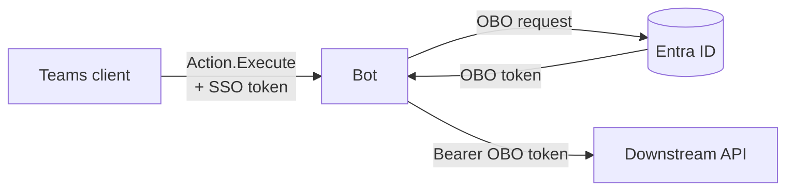
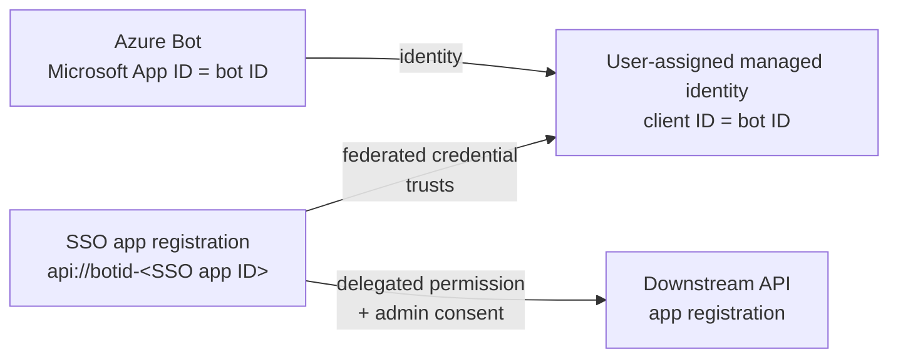

# Teams bot: Adaptive Card, silent SSO, on-behalf-of, your API

This proof of concept (POC) shows one flow. A user clicks a button on an Adaptive Card in Microsoft Teams. Then the bot sends a request to a different service, as that user. The service has its own Microsoft Entra ID app registration. The bot uses the OAuth 2.0 on-behalf-of (OBO) flow. The user does not see a sign-in window or an MFA prompt.

This documentation uses ASD-STE100 Simplified Technical English. Footnotes give the Microsoft source of each claim. A dagger (†) marks a source that only a search summary confirms.

- **Bot:** C# and .NET 10, with the [Teams SDK for .NET](https://github.com/microsoft/teams.net) (`Microsoft.Teams.Apps` 2.1.1)
- **Bot identity:** a user-assigned managed identity. The SSO app registration trusts it through a federated credential. In Azure, the bot has no secret.
- **OBO:** [MSAL.NET](https://github.com/AzureAD/microsoft-authentication-library-for-dotnet) (`AcquireTokenOnBehalfOf`, with a managed identity token as the client assertion)
- **Sample downstream API:** ASP.NET Core with [Microsoft.Identity.Web](https://github.com/AzureAD/microsoft-identity-web)



## Documents

| Document | Contents |
| --- | --- |
| [docs/how-obo-works.md](docs/how-obo-works.md) | How the OBO flow works, with diagrams: the tokens, the full sequence, the OBO request, the fallback path and the security controls |
| [docs/azure-setup.md](docs/azure-setup.md) | Procedures for the managed identity, the app registrations, the Azure Bot, the OAuth connection, the Azure host and the Teams app |
| [docs/troubleshooting.md](docs/troubleshooting.md) | Symptoms, probable causes and corrective actions |

## Why the bot had a token with only the user name in it

A bot does not get a user access token by default. These items are not usable for OBO:

| Item | What it is | Usable for OBO |
| --- | --- | --- |
| The `Authorization: Bearer` header of a request to `/api/messages` | A service token from the Bot Connector. `iss` is `https://api.botframework.com` and `aud` is the bot ID.[^sdk-issuer] It identifies the Bot Connector, not the user.[^connector-auth] | No |
| `activity.from` (`name`, `aadObjectId`) | Data about the user. It is not a token. | No |
| A token with `name` and `preferred_username`, but no `scp` claim | Usually an ID token. It identifies the user to a client app. It does not give access to an API. Only a user access token has `scp`.[^claims] | No |
| The SSO token that this POC gets: `aud` is the SSO app registration, `scp` is `access_as_user`, `azp` is a Teams client ID | An access token for the API of the SSO app registration. Entra ID gives it to the Teams client for this user.[^ua-handle] | Yes. This token is the OBO assertion.[^obo-request] |

The bot must ask the Teams client for the SSO token. For Adaptive Cards, the bot uses the SSO steps of Universal Actions (`Action.Execute`). Microsoft gives the protocol in its Universal Actions SSO documentation.[^ua-handle][^ua-receive]

## How it works

1. The user clicks the card button. Teams sends an `adaptiveCard/action` invoke activity to the bot.
2. The bot replies with a `loginRequest` that contains a `tokenExchangeResource`.
3. The Teams client gets the SSO token from Entra ID without a prompt. Then it sends the same invoke activity again with the SSO token.
4. The bot validates the SSO token. Then it sends the SSO token to Entra ID in an OBO request.
5. Entra ID returns the OBO token. The audience of this token is the downstream API.
6. The bot sends a request to the downstream API with the OBO token. Then it returns a new card.

If Entra ID cannot give the OBO token without an action from the user, Teams shows a Sign in button one time. For the full sequence and the diagrams, read [docs/how-obo-works.md](docs/how-obo-works.md).

The class [`CardActionSso`](src/Bot/Sso/CardActionSso.cs) does the SSO steps. Give it a card action handler. The handler gets an access token for your API:

```csharp
bot.OnAdaptiveCardAction((context, ct) =>
    sso.HandleAsync(CardActionTurn.FromContext(context), async (turn, token, ct2) =>
    {
        var result = await downstreamApi.GetMeAsync(token.AccessToken, ct2);
        return CardActionResponses.Card(Cards.Result(result, token, showDiagnostics));
    }, ct));
```

## The bot identity: a user-assigned managed identity

The Azure Bot has the type User-Assigned Managed Identity.[^bot-types] In Azure, the bot uses no secret.



- The Teams SDK uses the managed identity for Bot Framework traffic. It does this when `AzureAd` has a `ClientId` and no `ClientCredentials`.[^sdk-uami-config][^sdk-mi]
- A managed identity cannot expose an API scope. For this reason, Teams SSO uses a separate SSO app registration.[^uami-sso] The SSO token is for this app, so the OBO request must come from this app.[^obo-request]
- The SSO app registration has a federated credential that trusts the managed identity.[^fic][^mi-fic] For the OBO request, the bot gets a managed identity token for `api://AzureADTokenExchange`. The bot sends this token as the client assertion of the SSO app. It does not send a secret.[^fic-msal]
- The bot has one identity. You set it one time, in `AzureAd:ClientId`. In `SsoApp`, you set only the client ID of the SSO app registration.
- On your computer, there is no managed identity.[^mi-overview] There, the bot uses the SSO app registration with a client secret. Read [docs/azure-setup.md](docs/azure-setup.md), step 7.

The class [`SsoAppCredential`](src/Bot/Sso/SsoAppCredential.cs) adds the credential to MSAL.NET.

## Conditions for no prompt

Make sure that all of these conditions are true. If one condition is false, the user sees a consent dialog or a Sign in button.

1. The SSO app registration exposes the scope `access_as_user` at the Application ID URI `api://botid-<SSO app ID>`.[^bot-uri]
2. The Teams client IDs have pre-authorization for this scope: `1fec8e78-bce4-4aaf-ab1b-5451cc387264` (desktop and mobile) and `5e3ce6c0-2b1f-4285-8d4b-75ee78787346` (web).[^bot-clients]
3. In the manifest, `webApplicationInfo.id` is the SSO app ID. `webApplicationInfo.resource` is the Application ID URI.[^bot-manifest]
4. The SSO app registration has the delegated permission `access_as_user` of the downstream API. An administrator gave admin consent.[^obo-admin]
5. The Token Exchange URL of the OAuth connection on the Azure Bot is the Application ID URI.[^bot-oauth]
6. The user installed the app in the personal scope.[^ua-handle]
7. The card is in a one-on-one chat or a group chat. Microsoft does not support bot SSO in channels.[^bot-sso-scope]

The SSO token comes from the current Teams session of the user. A Conditional Access policy of the downstream API can ask for MFA. If the user did not sign in with MFA, the OBO request fails.[^ca-obo] Then the bot shows the Sign in button. If the Teams sign-in used MFA, this POC expects no prompt. Microsoft does not state this case directly, so do a test with your policies.

## The two strategies (`Sso:TokenStrategy`)

| Item | `Obo` (default) | `TokenService` |
| --- | --- | --- |
| Component that sends the OBO request | The bot, with MSAL.NET `AcquireTokenOnBehalfOf` and the managed identity as the credential | The Bot Framework token service, with the client ID, credential and scopes of the OAuth connection |
| Token storage | MSAL.NET memory cache only. Each click starts the SSO steps again. | The token service keeps the token and refreshes it. Later clicks do not start the SSO steps. |
| Number of downstream APIs | Many. The bot can use one SSO token for many APIs. | One API for each OAuth connection |
| Conditional Access claims challenge | The code gets it in `InteractionRequiredException.Claims` | The token service does not give it to the code |

The two strategies use the same Azure configuration. The Scopes setting of the OAuth connection must be the downstream scope, because the sign-in fallback uses it.

## Which SDK to use

- **TeamsFx SDK.** Microsoft no longer supports this SDK. The Teams SDK and the Microsoft 365 Agents SDK replace it.[^legacy] Do not use it for new work. Its `TeamsBotSsoPrompt` and `OnBehalfOfUserCredential` used the same pattern.
- **Teams SDK.** Microsoft changed the name of the Teams AI library to Teams SDK. It replaces the Bot Framework SDK for bots that operate only in Teams.[^legacy][^tools-sdks] This POC uses it (`Microsoft.Teams.Apps` for .NET).
- **Microsoft 365 Agents SDK.** Use it if the same agent must also operate in Microsoft 365 Copilot or in other channels.[^tools-sdks] Microsoft no longer supports the Bot Framework SDK.[^legacy] The protocol is the same, so you can move `src/Bot/Sso/` to it.

The Teams SDK gives the web host, the Bot Framework authentication, the activity routes and the token service client. The SSO steps for cards are in this POC, for two reasons:

- The `OAuthFlow` class of the SDK sends OAuth cards. It does not make the `loginRequest` of `Action.Execute`.[^sdk-oauthflow]
- The `AdaptiveCardActionValue` class of the SDK does not contain `value.authentication`.[^sdk-value] For this reason, `CardActionTurn` reads the raw JSON of the invoke activity.

## Run the POC

Before you start, read [docs/azure-setup.md](docs/azure-setup.md), section 0.

1. Run the tests. The tests use a test tenant, so they do not use Azure.

   ```bash
   dotnet test --solution TeamsSsoObo.slnx
   ```

2. Do the setup in [docs/azure-setup.md](docs/azure-setup.md). The script `scripts/setup-entra.sh` makes the identities. In Azure, deploy the bot as in step 6 of that document. Steps 3 and 4 are only for a run on your computer (step 7 of that document).
3. Start the downstream API on port 5000:

   ```bash
   dotnet run --project src/DownstreamApi
   ```

4. Start the bot on port 3978. Make sure that your tunnel goes to this port.

   ```bash
   dotnet run --project src/Bot
   ```

5. Make the Teams app package, then upload it to Teams:

   ```bash
   dotnet run scripts/package-app.cs -- <bot ID> <SSO app ID>
   ```

6. Send a message to the bot. On the card, select **Call downstream API**.

The result card shows the user data that the API received. If `Sso:ShowDiagnostics` is `true`, the card also shows the decoded claims of the two tokens. These claims show the chain of tokens:

- The `azp` claim of the SSO token is the Teams client.
- The `azp` claim of the OBO token is the SSO app registration.
- The `aud` claim of the OBO token is the API.

To remove the tokens from the Bot Framework token store, send `signout` to the bot.

## Configuration (`src/Bot/appsettings.json`)

| Key | Description |
| --- | --- |
| `AzureAd:TenantId`, `AzureAd:ClientId` | The identity of the Azure Bot. The Teams SDK uses it for Bot Framework traffic. In Azure, `ClientId` is the client ID of the managed identity, and `AzureAd` has no `ClientCredentials`. |
| `AzureAd:ClientCredentials:0:SourceType`, `AzureAd:ClientCredentials:0:ClientSecret` | Only on your computer: `ClientSecret` and the secret of the SSO app registration. Keep the secret in user-secrets. |
| `SsoApp:ClientId` | The SSO app registration. It is not a second identity of the bot. If it is empty, the bot uses the `AzureAd` app registration for SSO and OBO. |
| `SsoApp:ClientCredentials` | Optional. If the bot is a managed identity, the default credential is that managed identity. Set it only to use a different credential, or to set `TokenExchangeUrl` for a sovereign cloud. The default `TokenExchangeUrl` is `api://AzureADTokenExchange`. |
| `Sso:OAuthConnectionName` | The name of the OAuth connection on the Azure Bot. The default is `sso`. |
| `Sso:BotAppIdUri` | The default is `api://botid-<SSO app ID>`. It must be the same as the SSO app registration, the manifest and the OAuth connection. |
| `Sso:TokenStrategy` | `Obo` (default) or `TokenService` |
| `Sso:ShowDiagnostics` | POC only. Shows decoded claims and error details on the cards. |
| `DownstreamApi:Url`, `DownstreamApi:Scopes` | The API and its delegated scope, for example `api://<API client ID>/access_as_user` |

## Layout

```
src/Bot/
  Sso/CardActionSso.cs              SSO steps: 401 loginRequest, SSO token, 412, magic code
  Sso/DownstreamTokenStrategies.cs  SSO token to OBO token: MSAL.NET OBO or the token service
  Sso/SsoAppCredential.cs           credential of the SSO app: managed identity token or client secret
  Sso/SsoTokenValidator.cs          validates the SSO token and the user
  Sso/TokenServiceClient.cs         requests to the Bot Framework token service
  Sso/CardActionTurn.cs             reads the raw invoke value and value.authentication
  Sso/CardActionResponses.cs        invoke response bodies: loginRequest, 412, card, error
  CardActionHandlers.cs             the callApi verb: SSO, API request, result or error card
  Program.cs                        hosting and handlers: welcome card, signout, card actions
src/DownstreamApi/                  sample API: Microsoft.Identity.Web, RequireScope, no app-only tokens
test/Bot.Tests/                     tests of the SSO steps, the strategies, the validator, end to end
test/DownstreamApi.Tests/           tests of the token validation in the API
test/TestSupport/                   test tenant (signing key and tokens) and in-process API host
appPackage/                         Teams manifest template (webApplicationInfo) and icons
docs/                               how OBO works, Azure setup, troubleshooting
scripts/                            identity setup script (Azure CLI) and app package script (.NET)
```

## Before you use this in production

- **Secrets.** In Azure, the bot has no secret. The OAuth connection on the Azure Bot has a secret, unless it uses **AAD v2 with Federated Credentials**.[^bot-fic] Remove the local client secret of the SSO app registration when you do not use it.
- **More than one instance.** With `Obo`, add a distributed token cache to MSAL.NET (`Microsoft.Identity.Web.TokenCache`).[^msal-cache] With `TokenService`, the cache is already external.
- **Group chats and channels.** A bot can send a sign-in request from a card in a chat or a channel.[^ua-use-cases] But Microsoft does not support bot SSO in channels.[^bot-sso-scope] In a channel, the user sees the Sign in button. For a different card view for each user, use `refresh` with `userIds`.[^user-views]
- **Diagnostics.** Set `Sso:ShowDiagnostics` to `false`. Do not write raw tokens to logs or cards. This code does not do this.
- **Logs.** Do not use the `Trace` log level for `Microsoft.Teams`. At this level, the Teams SDK writes each invoke activity to the log, and the SSO token is in it.[^sdk-trace]
- **Your downstream service.** Validate tokens as `src/DownstreamApi` does. Examine the issuer, the audience and `scp`, and reject app-only tokens.[^tokens-validate][^miw-scopes] Then authorize the request with `oid`, `scp` and the roles.

[^sdk-issuer]: [Teams SDK for .NET source: BotConfig.cs, lines 23 to 27](https://github.com/microsoft/teams.net/blob/v2.1.1/src/Microsoft.Teams.Core/Hosting/BotConfig.cs#L23-L27). The default issuer is `https://api.botframework.com`.
[^connector-auth]: [Authentication with the Bot Connector API](https://learn.microsoft.com/azure/bot-service/rest-api/bot-framework-rest-connector-authentication) †. The bot must validate the token from the Bot Connector.
[^claims]: [Access token claims reference: Payload claims](https://learn.microsoft.com/entra/identity-platform/access-token-claims-reference#payload-claims). `scp` is "Only included for user tokens".
[^ua-handle]: [Add code to enable SSO for Adaptive Cards Universal Actions: Add code to handle an access token](https://learn.microsoft.com/microsoftteams/platform/task-modules-and-cards/cards/universal-actions-for-adaptive-cards/sso-adaptive-cards-universal-action#add-code-to-handle-an-access-token). The 401 `loginRequest` with `tokenExchangeResource`, and the install prompt for the personal scope.
[^ua-receive]: [Add code to enable SSO for Adaptive Cards Universal Actions: Add code to receive the token](https://learn.microsoft.com/microsoftteams/platform/task-modules-and-cards/cards/universal-actions-for-adaptive-cards/sso-adaptive-cards-universal-action#add-code-to-receive-the-token).
[^ua-use-cases]: [Enable SSO for Adaptive Cards Universal Actions: Use cases for enabling SSO](https://learn.microsoft.com/microsoftteams/platform/task-modules-and-cards/cards/universal-actions-for-adaptive-cards/enable-sso-for-your-adaptive-cards-universal-action#use-cases-for-enabling-sso).
[^user-views]: [User Specific Views: User Specific Views for Adaptive Cards](https://learn.microsoft.com/microsoftteams/platform/task-modules-and-cards/cards/universal-actions-for-adaptive-cards/user-specific-views#user-specific-views-for-adaptive-cards).
[^obo-request]: [Microsoft identity platform and OAuth 2.0 On-Behalf-Of flow: First case: Access token request with a shared secret](https://learn.microsoft.com/entra/identity-platform/v2-oauth2-on-behalf-of-flow#first-case-access-token-request-with-a-shared-secret).
[^obo-admin]: [On-Behalf-Of flow: Admin consent](https://learn.microsoft.com/entra/identity-platform/v2-oauth2-on-behalf-of-flow#admin-consent).
[^ca-obo]: [Developer guidance for Conditional Access: Scenario: App performing the on-behalf-of flow](https://learn.microsoft.com/entra/identity-platform/v2-conditional-access-dev-guide#scenario-app-performing-the-on-behalf-of-flow). The OBO request "fails since the user has not signed in with multifactor authentication".
[^bot-uri]: [Configure your bot app in Microsoft Entra ID: To configure application ID URI](https://learn.microsoft.com/microsoftteams/platform/bots/how-to/authentication/bot-sso-register-aad?tabs=botid#to-configure-application-id-uri).
[^bot-clients]: [Configure your bot app in Microsoft Entra ID: To configure authorized client application](https://learn.microsoft.com/microsoftteams/platform/bots/how-to/authentication/bot-sso-register-aad?tabs=botid#to-configure-authorized-client-application).
[^bot-oauth]: [Configure your bot app in Microsoft Entra ID: To update OAuth connection](https://learn.microsoft.com/microsoftteams/platform/bots/how-to/authentication/bot-sso-register-aad?tabs=botid#to-update-oauth-connection).
[^bot-manifest]: [Update app manifest for SSO: webApplicationInfo property](https://learn.microsoft.com/microsoftteams/platform/bots/how-to/authentication/bot-sso-manifest#webapplicationinfo-property).
[^bot-sso-scope]: [Enable SSO for your bot app](https://learn.microsoft.com/microsoftteams/platform/bots/how-to/authentication/bot-sso-overview). "SSO for a bot app in Teams is supported in one-on-one and group chat scope, and not supported in channel scope."
[^legacy]: [Legacy Teams app and agent development frameworks](https://learn.microsoft.com/microsoftteams/platform/legacy-tools-sdks). "Teams AI Library is now Teams SDK." The Bot Framework SDK and TeamsFx are no longer supported.
[^tools-sdks]: [Teams Platform tools and SDKs](https://learn.microsoft.com/microsoftteams/platform/concepts/build-and-test/tool-sdk-overview). The Teams SDK is the main toolkit. The Microsoft 365 Agents SDK is the multichannel alternative.
[^sdk-oauthflow]: [Teams SDK for .NET source: OAuthFlow.cs, lines 207 to 216](https://github.com/microsoft/teams.net/blob/v2.1.1/src/Microsoft.Teams.Apps/OAuth/OAuthFlow.cs#L207-L216). `OAuthFlow` builds an `OAuthCard`.
[^sdk-value]: [Teams SDK for .NET source: AdaptiveCardHandlers.Values.cs, lines 12 to 31](https://github.com/microsoft/teams.net/blob/v2.1.1/src/Microsoft.Teams.Apps/Handlers/AdaptiveCardHandlers.Values.cs#L12-L31).
[^sdk-mi]: [Teams SDK for .NET source: BotConfig.cs, lines 94 to 96](https://github.com/microsoft/teams.net/blob/v2.1.1/src/Microsoft.Teams.Core/Hosting/BotConfig.cs#L94-L96). An `AzureAd` section without client credentials means a user-assigned managed identity.
[^sdk-trace]: [Teams SDK for .NET source: Router.cs, line 188](https://github.com/microsoft/teams.net/blob/v2.1.1/src/Microsoft.Teams.Apps/Routing/Router.cs#L188).
[^fic]: [Configure an application to trust a managed identity](https://learn.microsoft.com/entra/workload-id/workload-identity-federation-config-app-trust-managed-identity). Lets an app use a managed identity token instead of a secret.
[^msal-cache]: [MSAL.NET: Token cache serialization](https://learn.microsoft.com/entra/msal/dotnet/how-to/token-cache-serialization) †. Recommends a distributed token cache for web apps and web APIs.
[^tokens-validate]: [Access tokens in the Microsoft identity platform: Validate tokens](https://learn.microsoft.com/entra/identity-platform/access-tokens#validate-tokens).
[^miw-scopes]: [Protected web API: Verify scopes and app roles: Verify scopes in APIs called on behalf of users](https://learn.microsoft.com/entra/identity-platform/scenario-protected-web-api-verification-scope-app-roles#verify-scopes-in-apis-called-on-behalf-of-users).
[^bot-types]: [Add authentication to your Teams bot: Create Azure Bot resource registration](https://learn.microsoft.com/microsoftteams/platform/bots/how-to/authentication/add-authentication#create-azure-bot-resource-registration). "All new bot registrations must either use the Single Tenant bot type or the User-Assigned Managed Identity type."
[^sdk-uami-config]: [Teams SDK documentation source: C# app authentication, line 94](https://github.com/microsoft/teams-sdk/blob/0187ab0b2c43a9f21e9398a593835802d62fbecb/teams.md/src/components/include/essentials/app-authentication/csharp.incl.md#L94). "automatically use User Assigned Managed Identity authentication when you provide the `ClientId` without a `ClientSecret`".
[^uami-sso]: [Enable SSO for your bot app: Enable SSO for a Teams app](https://learn.microsoft.com/microsoftteams/platform/bots/how-to/authentication/bot-sso-overview#enable-sso-for-a-teams-app). "If your bot is created using User-Assigned Managed Identity, an App Registration isn't automatically created. You must create a separate App Registration".
[^mi-overview]: [What is managed identities for Azure resources?: What are managed identities?](https://learn.microsoft.com/entra/identity/managed-identities-azure-resources/overview#what-are-managed-identities). "A managed identity is an identity that can be assigned to an Azure compute resource".
[^mi-fic]: [What is managed identities for Azure resources?: Use managed identity as a Federated Identity Credential (FIC) on an Entra ID app](https://learn.microsoft.com/entra/identity/managed-identities-azure-resources/overview#use-managed-identity-as-a-federated-identity-credential-fic-on-an-entra-id-app). "Whenever an Entra ID app is required, this is the recommended way to be credential-free."
[^fic-msal]: [Configure an application to trust a managed identity: MSAL (.NET)](https://learn.microsoft.com/entra/workload-id/workload-identity-federation-config-app-trust-managed-identity#msal-net). A managed identity token "can then be used as a client assertion when constructing a confidential client application".
[^bot-fic]: [Implement authentication with federated identity credentials](https://learn.microsoft.com/azure/bot-service/bot-builder-authentication-federated-credential) †. The OAuth connection service provider **AAD v2 with Federated Credentials**.
