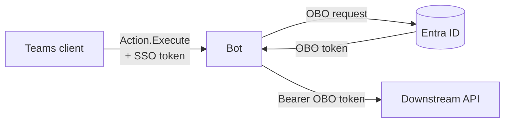

# Teams bot: Adaptive Card, silent SSO, on-behalf-of, your API

This proof of concept (POC) shows one flow. A user clicks a button on an Adaptive Card in Microsoft Teams. Then the bot sends a request to a different service, as that user. The service has its own Microsoft Entra ID app registration. The bot uses the OAuth 2.0 on-behalf-of (OBO) flow. The user does not see a sign-in window or an MFA prompt.

This documentation uses ASD-STE100 Simplified Technical English.

- **Bot:** C# and .NET 10, with the [Teams SDK for .NET](https://github.com/microsoft/teams.net) (`Microsoft.Teams.Apps` 2.1.1)
- **OBO:** [MSAL.NET](https://github.com/AzureAD/microsoft-authentication-library-for-dotnet) (`AcquireTokenOnBehalfOf`)
- **Sample downstream API:** ASP.NET Core with [Microsoft.Identity.Web](https://github.com/AzureAD/microsoft-identity-web)



## Documents

| Document | Contents |
| --- | --- |
| [docs/how-obo-works.md](docs/how-obo-works.md) | How the OBO flow works, with diagrams: the tokens, the full sequence, the OBO request, the fallback path and the security controls |
| [docs/azure-setup.md](docs/azure-setup.md) | Procedures for the app registrations, the Azure Bot, the OAuth connection and the Teams app |
| [docs/troubleshooting.md](docs/troubleshooting.md) | Symptoms, probable causes and corrective actions |

## Why the bot had a token with only the user name in it

A bot does not get a user access token by default. These items are not usable for OBO:

| Item | What it is | Usable for OBO |
| --- | --- | --- |
| The `Authorization: Bearer` header of a request to `/api/messages` | A service token from the Bot Connector. `iss` is `https://api.botframework.com` and `aud` is the bot ID. It identifies the Bot Connector, not the user. | No |
| `activity.from` (`name`, `aadObjectId`) | Data about the user. It is not a token. | No |
| A token with `name` and `preferred_username`, but no `scp` claim | Usually an ID token. It identifies the user to a client app. It does not give access to an API. | No |
| The SSO token that this POC gets: `aud` is the bot, `scp` is `access_as_user`, `azp` is a Teams client ID | An access token for the bot API. Entra ID gives it to the Teams client for this user. | Yes. This token is the OBO assertion. |

The bot must ask the Teams client for the SSO token. For Adaptive Cards, the bot uses the SSO steps of Universal Actions (`Action.Execute`). Microsoft gives the protocol in [Add code to enable SSO for Adaptive Cards Universal Actions](https://learn.microsoft.com/microsoftteams/platform/task-modules-and-cards/cards/universal-actions-for-adaptive-cards/sso-adaptive-cards-universal-action).

## How it works

1. The user clicks the card button. Teams sends an `adaptiveCard/action` invoke activity to the bot.
2. The bot replies with a `loginRequest` that contains a `tokenExchangeResource`.
3. The Teams client gets the SSO token from Entra ID without a prompt. Then it sends the same invoke activity again with the SSO token.
4. The bot validates the SSO token. Then it sends the SSO token to Entra ID in an OBO request.
5. Entra ID returns the OBO token. The audience of this token is the downstream API.
6. The bot sends a request to the downstream API with the OBO token. Then it returns a new card.

If Entra ID cannot give the OBO token without an action from the user, Teams shows a Sign in button one time. For the full sequence and the diagrams, read [docs/how-obo-works.md](docs/how-obo-works.md).

The class [`CardActionSso`](src/Bot/Sso/CardActionSso.cs) does the SSO steps. Give it a card action handler. The handler gets an access token for your API:

```csharp
bot.OnAdaptiveCardAction((context, ct) =>
    sso.HandleAsync(CardActionTurn.FromContext(context), async (turn, token, ct2) =>
    {
        var result = await downstreamApi.GetMeAsync(token.AccessToken, ct2);
        return CardActionResponses.Card(Cards.Result(result, token, showDiagnostics));
    }, ct));
```

## Conditions for no prompt

Make sure that all of these conditions are true. If one condition is false, the user sees a consent dialog or a Sign in button.

1. The bot app registration exposes the scope `access_as_user` at the Application ID URI `api://botid-<bot ID>`.
2. The Teams client IDs have pre-authorization for this scope: `1fec8e78-bce4-4aaf-ab1b-5451cc387264` (desktop and mobile) and `5e3ce6c0-2b1f-4285-8d4b-75ee78787346` (web).
3. In the manifest, `webApplicationInfo.id` is the bot ID. `webApplicationInfo.resource` is the Application ID URI.
4. The bot app registration has the delegated permission `access_as_user` of the downstream API. An administrator gave admin consent.
5. The Token Exchange URL of the OAuth connection on the Azure Bot is the Application ID URI.
6. The user installed the app in the personal scope.

The SSO token comes from the current Teams session of the user. If the user did MFA to sign in to Teams, Entra ID keeps it in the OBO flow. A prompt occurs only if a Conditional Access policy of the downstream API asks for more. Then the bot shows the Sign in button.

## The two strategies (`Sso:TokenStrategy`)

| Item | `Obo` (default) | `TokenService` |
| --- | --- | --- |
| Component that sends the OBO request | The bot, with MSAL.NET `AcquireTokenOnBehalfOf` | The Bot Framework token service, with the client ID, secret and scopes of the OAuth connection |
| Token storage | MSAL.NET memory cache only. Each click starts the SSO steps again. | The token service keeps the token and refreshes it. Later clicks do not start the SSO steps. |
| Number of downstream APIs | Many. The bot can use one SSO token for many APIs. | One API for each OAuth connection |
| Conditional Access claims challenge | The code gets it in `InteractionRequiredException.Claims` | The token service does not give it to the code |

The two strategies use the same Azure configuration. The Scopes setting of the OAuth connection must be the downstream scope, because the sign-in fallback uses it.

## Which SDK to use

- **TeamsFx SDK.** Microsoft gives only community support for this SDK. Do not use it for new work. Its `TeamsBotSsoPrompt` and `OnBehalfOfUserCredential` used the same pattern.
- **Teams SDK.** Microsoft changed the name of the Teams AI library to Teams SDK. Microsoft recommends it for bots that operate only in Teams. This POC uses it (`Microsoft.Teams.Apps` for .NET).
- **Microsoft 365 Agents SDK.** This SDK replaces the Bot Framework SDK. Use it if the same agent must also operate in Microsoft 365 Copilot or in other channels. The protocol is the same, so you can move `src/Bot/Sso/` to it.

The Teams SDK gives the web host, the Bot Framework authentication, the activity routes and the token service client. The SSO steps for cards are in this POC, for two reasons:

- The `OAuthFlow` class of the SDK supports OAuth cards only. It does not support the `loginRequest` of `Action.Execute`.
- The `AdaptiveCardActionValue` class of the SDK does not contain `value.authentication`. For this reason, `CardActionTurn` reads the raw JSON of the invoke activity.

## Run the POC

Before you start, read [docs/azure-setup.md](docs/azure-setup.md), section 0.

1. Run the tests. The tests use a test tenant, so they do not use Azure.

   ```bash
   dotnet test --solution TeamsSsoObo.slnx
   ```

2. Do the setup in [docs/azure-setup.md](docs/azure-setup.md). The script `scripts/setup-entra.sh` keeps the settings in `dotnet user-secrets`.
3. Start the downstream API on port 5000:

   ```bash
   dotnet run --project src/DownstreamApi
   ```

4. Start the bot on port 3978. Make sure that your tunnel goes to this port.

   ```bash
   dotnet run --project src/Bot
   ```

5. Make the Teams app package, then upload it to Teams:

   ```bash
   dotnet run scripts/package-app.cs -- <bot client ID>
   ```

6. Send a message to the bot. On the card, select **Call downstream API**.

The result card shows the user data that the API received. If `Sso:ShowDiagnostics` is `true`, the card also shows the decoded claims of the two tokens. These claims show the chain of tokens:

- The `azp` claim of the SSO token is the Teams client.
- The `azp` claim of the OBO token is the bot.
- The `aud` claim of the OBO token is the API.

To remove the tokens from the Bot Framework token store, send `signout` to the bot.

## Configuration (`src/Bot/appsettings.json`)

| Key | Description |
| --- | --- |
| `AzureAd:TenantId`, `AzureAd:ClientId`, `AzureAd:ClientCredentials:0:ClientSecret` | The bot app registration. The Teams SDK uses it for Bot Framework traffic. The bot uses it for the OBO request. Keep the secret in user-secrets or Key Vault. |
| `Sso:OAuthConnectionName` | The name of the OAuth connection on the Azure Bot. The default is `sso`. |
| `Sso:BotAppIdUri` | The default is `api://botid-<ClientId>`. It must be the same as the app registration, the manifest and the OAuth connection. |
| `Sso:TokenStrategy` | `Obo` (default) or `TokenService` |
| `Sso:ShowDiagnostics` | POC only. Shows decoded claims and error details on the cards. |
| `DownstreamApi:Url`, `DownstreamApi:Scopes` | The API and its delegated scope, for example `api://<API client ID>/access_as_user` |

## Layout

```
src/Bot/
  Sso/CardActionSso.cs              SSO steps: 401 loginRequest, SSO token, 412, magic code
  Sso/DownstreamTokenStrategies.cs  SSO token to OBO token: MSAL.NET OBO or the token service
  Sso/SsoTokenValidator.cs          validates the SSO token and the user
  Sso/TokenServiceClient.cs         requests to the Bot Framework token service
  Sso/CardActionTurn.cs             reads the raw invoke value and value.authentication
  Sso/CardActionResponses.cs        invoke response bodies: loginRequest, 412, card, error
  CardActionHandlers.cs             the callApi verb: SSO, API request, result or error card
  Program.cs                        hosting and handlers: welcome card, signout, card actions
src/DownstreamApi/                  sample API: Microsoft.Identity.Web, RequireScope, no app-only tokens
test/Bot.Tests/                     tests of the SSO steps, the strategies, the validator, end to end
test/DownstreamApi.Tests/           tests of the token validation in the API
test/TestSupport/                   test tenant (signing key and tokens) and in-process API host
appPackage/                         Teams manifest template (webApplicationInfo) and icons
docs/                               how OBO works, Azure setup, troubleshooting
scripts/                            Entra setup script (Azure CLI) and app package script (.NET)
```

## Before you use this in production

- **Secrets.** Do not use a client secret. Use a certificate, or a managed identity with a federated credential. MSAL.NET has `WithCertificate` and `WithClientAssertion`. The Teams SDK reads a managed identity from the `AzureAd` section.
- **More than one instance.** With `Obo`, add a distributed token cache to MSAL.NET (`Microsoft.Identity.Web.TokenCache`). With `TokenService`, the cache is already external.
- **Group chats and channels.** Microsoft documents `Action.Execute` sign-in for group chats and channels. Do a test of SSO in these conversations. The `OAuthFlow` class of the SDK does not use SSO in channels. For a different card view for each user, use `refresh` with `userIds`.
- **Diagnostics.** Set `Sso:ShowDiagnostics` to `false`. Do not write raw tokens to logs or cards. This code does not do this.
- **Logs.** Do not use the `Trace` log level for `Microsoft.Teams`. At this level, the Teams SDK writes each invoke activity to the log, and the SSO token is in it.
- **Your downstream service.** Validate tokens as `src/DownstreamApi` does. Examine the issuer, the audience and `scp`, and reject app-only tokens. Then authorize the request with `oid`, `scp` and the roles.
