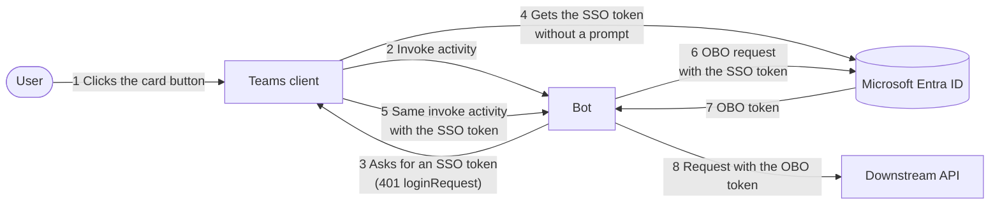
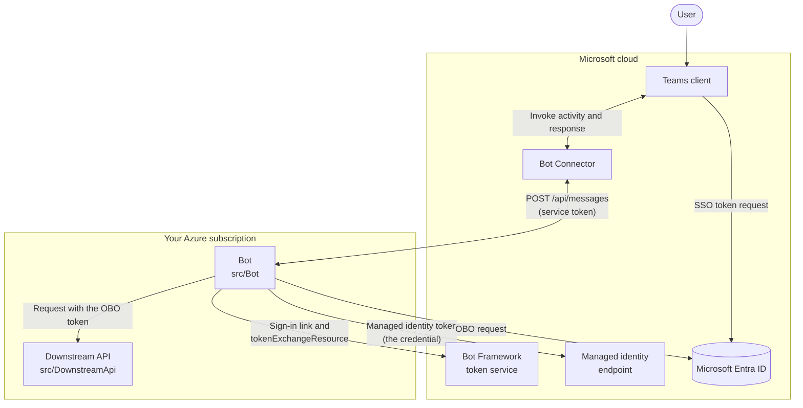
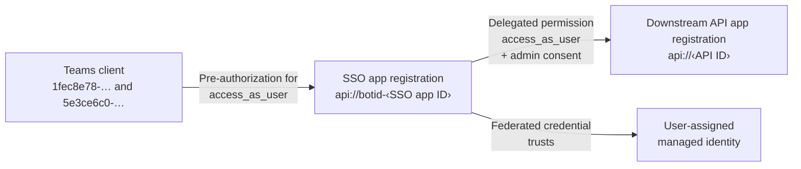
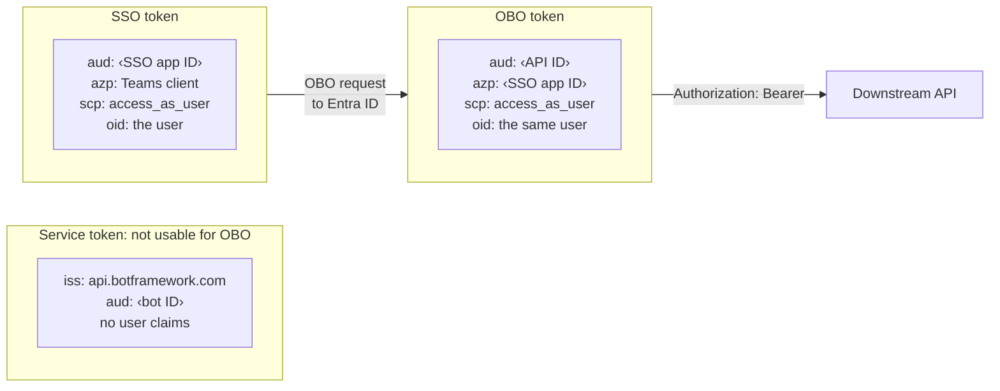
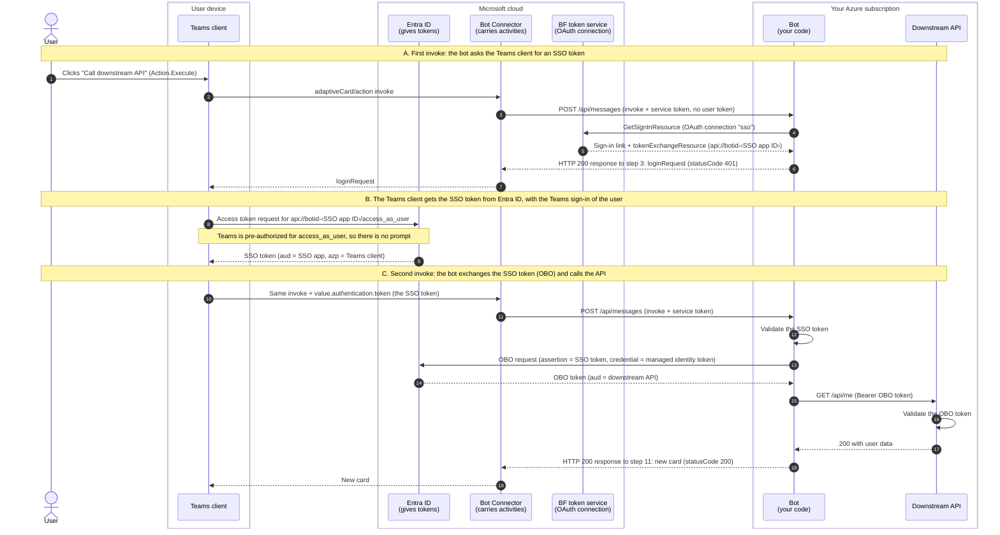
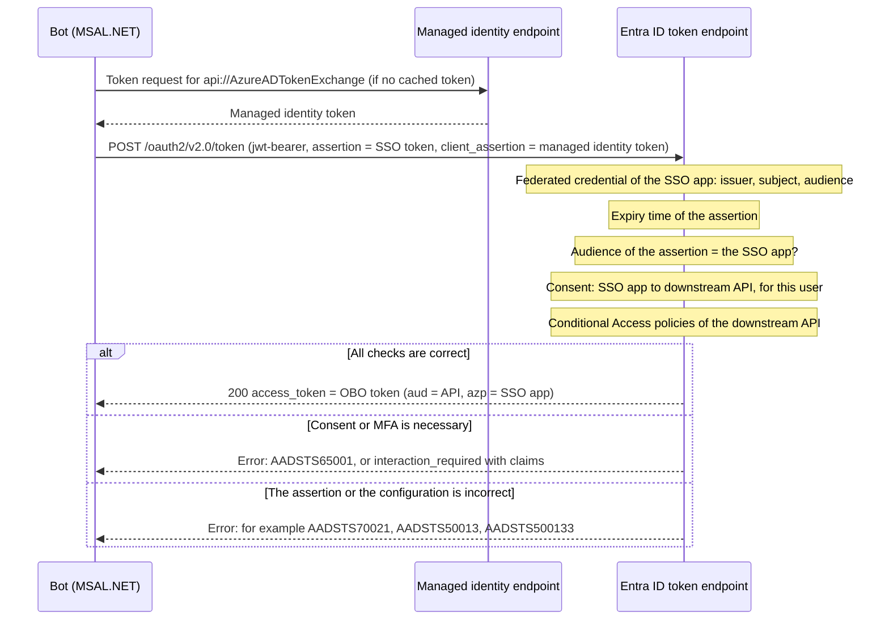
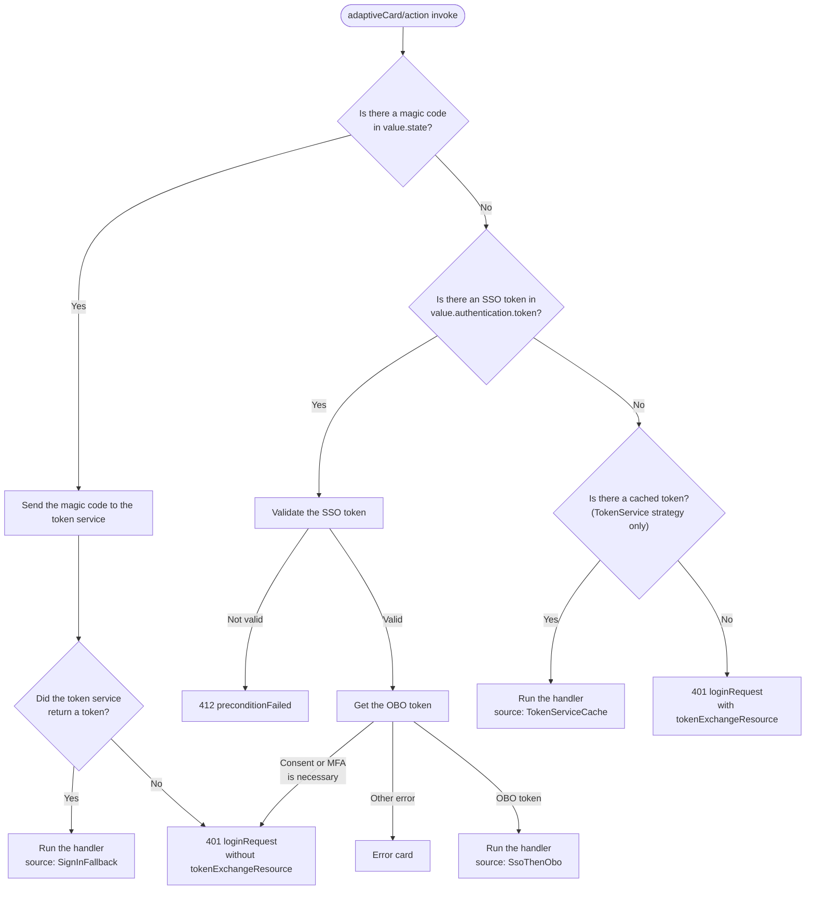
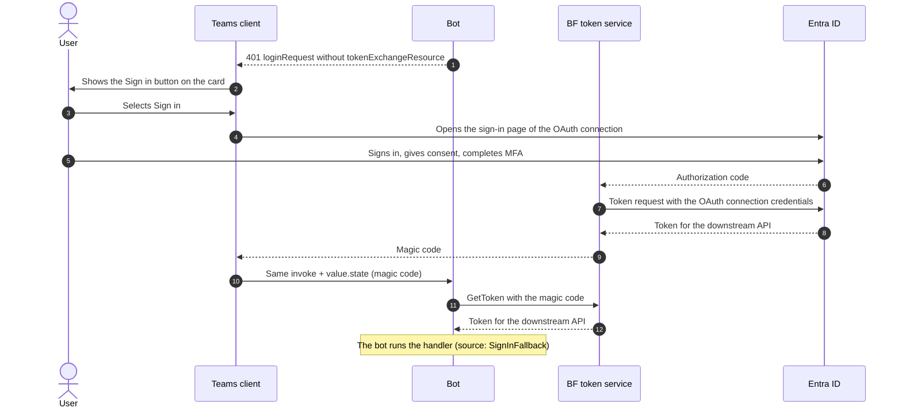
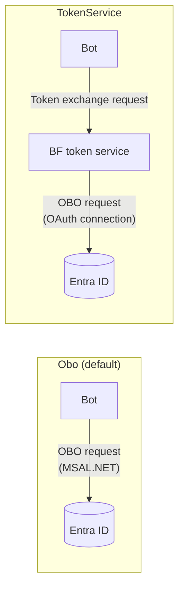

# How the on-behalf-of (OBO) flow works

This document uses ASD-STE100 Simplified Technical English. Section 15 gives the rules that it applies.

Each claim has a footnote to its source. The footnotes are at the end of this document. Section 16 gives the method for the source checks.

## 1 Purpose

This document tells you how the bot gets a token for the downstream API. The token is for the user who clicks the card button. The user does not see a sign-in window or an MFA prompt.

Read this document before you change the code in `src/Bot/Sso/`.

## 2 Summary

The bot cannot get a user token directly from Microsoft Entra ID. Only the Teams client has a session for the user. The bot asks the Teams client for a token, and the Teams client gets it from Entra ID.[^ua-runtime] The flow has two parts:

1. The bot asks the Teams client for a token. The Teams client gets this token from Entra ID without a prompt. This token is the SSO token. The SSO token is only for the SSO app registration of the bot.[^ua-handle][^uami-sso]
2. The bot sends the SSO token to Entra ID and asks for a token for the downstream API. This step is the on-behalf-of (OBO) flow. Entra ID returns the OBO token.[^obo-protocol]

The OBO token is for the downstream API. It identifies the same user as the SSO token. The bot sends the OBO token to the downstream API in the `Authorization` header.[^obo-protocol]

The bot sends the OBO request as the SSO app registration. The credential is a token of the user-assigned managed identity of the bot, not a secret.[^mi-fic][^fic-msal]



## 3 Terms

| Term | Description |
| --- | --- |
| Access token | A JSON Web Token (JWT) that Entra ID signs. An API accepts the token as the identity of the caller and the user.[^tokens-validate] |
| Audience (`aud` claim) | The API that the token is for. An API must reject a token that has a different audience.[^claims] |
| Scope (`scp` claim) | The delegated permission in the token, for example `access_as_user`. Only a user token has this claim.[^claims] |
| Authorized party (`azp` claim, `appid` in v1 tokens) | The app that asked Entra ID for the token.[^claims] |
| Object ID (`oid` claim) | The ID of the user in Entra ID.[^claims] |
| SSO token | The access token that the Teams client gets for the SSO app registration of the bot. The audience is the SSO app. The authorized party is the Teams client. |
| OBO token | The access token that the bot gets for the downstream API, as the SSO app. The audience is the downstream API. The authorized party is the SSO app. |
| Service token | The token in the `Authorization` header of each request from the Bot Connector to the bot. It identifies the Bot Connector. It does not identify the user.[^connector-auth] |
| Assertion | The token that the bot sends in the OBO request. In this flow, the assertion is the SSO token.[^obo-request] |
| Pre-authorization | A setting in the SSO app registration. It lets the Teams client get the SSO token without a consent prompt.[^consent-preauth] |
| Admin consent | A permission that an administrator gives for all users in the tenant. It lets the bot get the OBO token without a consent prompt.[^consent-admin] |
| OAuth connection | A setting on the Azure Bot resource. The Bot Framework token service uses it for the sign-in link and for the token exchange.[^bot-oauth] |
| Managed identity | An identity that Azure assigns to an Azure resource, for example the host of the bot. The resource gets tokens for the identity without a secret.[^mi-overview] |
| Federated credential | A credential of an app registration that trusts the tokens of a different identity. Here, the SSO app registration trusts the managed identity.[^fic-values] |
| Client assertion | A token that an app sends instead of a secret, to prove its identity. Here, it is a managed identity token.[^fic-msal][^obo-cert] |
| Magic code | A one-time code. The Teams client sends it to the bot in the `state` field after the user signs in with the Sign in button. Microsoft calls it the "authorization code" in this flow.[^ua-flow] |

## 4 Parts of the system

Eight parts take part in the flow. Microsoft operates the Teams client, the Bot Connector, the Bot Framework token service, the managed identity endpoint and Entra ID. You operate the bot and the downstream API.



Four identities take part in the flow:

| App | Client ID | Function in the flow |
| --- | --- | --- |
| Teams client | `1fec8e78-bce4-4aaf-ab1b-5451cc387264` (desktop and mobile), `5e3ce6c0-2b1f-4285-8d4b-75ee78787346` (web)[^bot-clients] | Microsoft owns these apps. The Teams client asks Entra ID for the SSO token. |
| User-assigned managed identity | Your bot ID | The identity of the Azure Bot. The Agents SDK uses it for Bot Framework traffic.[^asdk-uami] It is also the credential of the SSO app registration.[^mi-fic] |
| SSO app registration | Your SSO app ID | It exposes the scope `api://botid-<SSO app ID>/access_as_user`.[^bot-uri] The bot asks for the OBO token as this app. A managed identity cannot expose a scope, so this app is necessary.[^uami-sso] |
| Downstream API app registration | Your API ID | It exposes the scope `api://<API ID>/access_as_user`.[^expose-api] The downstream API accepts the OBO token. |

Two permissions and one federated credential connect the identities. Each permission removes one consent prompt.[^consent-preauth][^consent-admin] The federated credential removes the secret.[^mi-fic]



## 5 The three tokens

Each request from the Bot Connector to the bot has a service token. The bot must validate this token.[^connector-auth] The Agents SDK expects the issuer `https://api.botframework.com`.[^asdk-issuer] The service token identifies the Bot Connector. It has no user claims and no `scp` claim, so it is not a user token.

The user name in a request comes from `activity.from`. This field is not a token. The bot cannot use it to get a token.

The OBO request must contain a user access token that has the audience of the app that sends the request.[^obo-request] Here, that app is the SSO app registration. The bot gets this SSO token from the Teams client. Then the bot uses the SSO token to get the OBO token.



| Claim | Service token | SSO token | OBO token |
| --- | --- | --- | --- |
| `iss` | `https://api.botframework.com`[^asdk-issuer] | Entra ID, your tenant | Entra ID, your tenant |
| `aud` | Bot ID | SSO app ID (v2). In v1 tokens, the client ID or the resource URI, for example `api://botid-<SSO app ID>`.[^claims] | API ID (v2). In v1 tokens, the client ID or `api://<API ID>`.[^claims] |
| `azp` or `appid` | None | Teams client ID | SSO app ID |
| `scp` | None | `access_as_user` | `access_as_user` |
| `oid`, `tid`, `name` | None | The user | The same user |
| Sender and receiver | Bot Connector to bot | Teams client to bot | Bot to downstream API |

The token version comes from the `requestedAccessTokenVersion` setting of the API app registration. If the setting is empty, the version is 1.[^manifest-version] The setup in this POC sets it to 2.[^bot-version]

CAUTION: Do not send the SSO token to the downstream API. An API must accept only tokens that have its own audience.[^tokens-validate] The audience of the SSO token is the SSO app.

## 6 The full sequence

This sequence shows the silent path. The user clicks once and sees the result. Steps 4 to 11 occur without a prompt.

### 6.1 The three parts with "bot" in their name

The Bot Connector, the bot and the BF token service are three different parts. Microsoft operates two of them. You operate the bot.

| Part | Operator | Function in this flow | Not a function of this part |
| --- | --- | --- | --- |
| Bot Connector | Microsoft. For Teams, its service URLs are on `smba.trafficmanager.net`.[^asdk-hosts] | It carries each activity from the Teams client to the messaging endpoint of the bot.[^bot-endpoint] It adds its service token to each request.[^connector-auth] It carries the HTTP response of the bot back to the Teams client. | It does not give user tokens. It does not run your code. |
| Bot | You. It is `src/Bot` on your Azure host. | It receives activities at `/api/messages`. It asks the Teams client for the SSO token, validates it, sends the OBO request and calls the downstream API. | It cannot get a user token directly from Entra ID, because it has no session for the user.[^ua-runtime] |
| BF token service | Microsoft (`token.botframework.com`). | It keeps the OAuth connection of the Azure Bot.[^bot-oauth] It gives the sign-in link and the `tokenExchangeResource` (steps 4 and 5). In the fallback, it keeps the token of the user.[^sso-runtime] With the `TokenService` strategy, it also sends the OBO request (section 13). | It does not carry activities. With the `Obo` strategy, the SSO token does not go through it. |

The Azure Bot resource has the settings for the two Microsoft parts. The messaging endpoint is for the Bot Connector.[^bot-endpoint] The OAuth connection is for the BF token service.[^bot-oauth]

### 6.2 Why the SSO token goes from Entra ID to the Teams client

1. Only the Teams client has a session for the user. The user signed in to Teams, not to the bot.[^ua-runtime]
2. For this reason, the bot asks the Teams client for a token. It sends a `loginRequest` with a `tokenExchangeResource` (steps 6 and 7).[^ua-handle]
3. The Teams client asks Entra ID for an access token for the SSO app. It uses the session of the user (step 8). Microsoft writes that this card "is used to get an access token from Microsoft Entra ID using `tokenExchangeResource`".[^ua-runtime]
4. The Teams client has pre-authorization for the scope `access_as_user`. For this reason, Entra ID does not show a consent prompt.[^bot-clients]
5. Entra ID returns the access token to the Teams client, because the Teams client sent the request (step 9). This access token is the SSO token. Its audience is the SSO app, and its authorized party is the Teams client (section 5).
6. The Teams client sends the same invoke activity again, with the SSO token in it (steps 10 and 11).[^ua-runtime][^ua-receive]

The SSO token is not a token for the downstream API. The bot uses it only as the assertion of the OBO request.[^obo-request]

### 6.3 The sequence



| Step | Description | Code |
| --- | --- | --- |
| 1 | The user clicks the `Action.Execute` button on the card. | `Cards.Welcome` |
| 2 to 3 | Teams sends an `adaptiveCard/action` invoke activity.[^asdk-actions] The Bot Connector sends it to the messaging endpoint of the bot, with its service token. The service token identifies the Bot Connector, not the user. The bot validates the service token with the Microsoft sample code.[^connector-auth][^asdk-auth-sample] | `SsoBot`, `AdaptiveCards.OnActionExecute` |
| 4 to 5 | The bot asks the BF token service for the sign-in resource of the OAuth connection. The response has a sign-in link and a `tokenExchangeResource`. The sign-in state must contain the app ID, or the token service does not return a `tokenExchangeResource`. The Agents SDK puts the app ID in the sign-in state.[^asdk-state] | `TokenServiceClient.GetSignInResourceAsync` |
| 6 to 7 | The bot replies with a `loginRequest`. The body has `statusCode` 401 and the `tokenExchangeResource`.[^ua-handle] The reply is the HTTP response to step 3. The HTTP status is 200, as in the Microsoft C# sample.[^sample-401][^botbuilder-invoke] The Agents SDK also uses HTTP status 200.[^asdk-route] The Bot Connector sends the reply to the Teams client. | `CardActionSso`, `CardActionResponses.LoginRequest` |
| 8 to 9 | The Teams client uses the `tokenExchangeResource` to get a token from Entra ID.[^ua-handle][^ua-runtime] It uses the current session of the user. Entra ID returns the SSO token to the Teams client. Section 6.2 gives the reason. | Teams client |
| 10 to 11 | The Teams client sends the same invoke activity again, through the Bot Connector. The SSO token is in `value.authentication.token`.[^ua-receive] The Agents SDK type for this value has `authentication` and `state`.[^asdk-value] | `CardActionTurn.FromContext` |
| 12 | The bot validates the SSO token. Section 12 gives the checks. | `SsoTokenValidator` |
| 13 to 14 | The bot sends the OBO request to Entra ID as the SSO app. A managed identity token is the credential. Entra ID returns the OBO token. Section 7 gives the details.[^obo-request] | `OboTokenStrategy`, `MsalOboTokenAcquirer`, `SsoAppCredential` |
| 15 to 17 | The bot sends a request to the downstream API with the OBO token. The API validates the token and returns the user data.[^miw-validation] | `DownstreamApiClient`, `src/DownstreamApi/Program.cs` |
| 18 to 19 | The bot returns a new card in the HTTP response to step 11. The HTTP status is 200, and the body has `statusCode` 200. The Bot Connector sends the card to the Teams client. | `Cards.Result` |

NOTE: The bot does steps 4 to 11 on each click when `Sso:TokenStrategy` is `Obo`. For tabs, Microsoft documents that Teams keeps the SSO token in a cache.[^tab-cache] For bots, Microsoft does not document this behavior.

## 7 The OBO request

The bot uses MSAL.NET for the OBO request.[^msal-obo] The bot sends the request as the SSO app registration. First, MSAL.NET gets a token from the managed identity of the bot. The audience of this token is `api://AzureADTokenExchange`.[^fic-msal][^fic-values] Then MSAL.NET sends this HTTP request to the token endpoint of Entra ID:[^obo-request][^obo-cert]

```http
POST https://login.microsoftonline.com/{tenant-id}/oauth2/v2.0/token
Content-Type: application/x-www-form-urlencoded

grant_type=urn:ietf:params:oauth:grant-type:jwt-bearer
&requested_token_use=on_behalf_of
&client_id={sso-app-id}
&client_assertion_type=urn:ietf:params:oauth:client-assertion-type:jwt-bearer
&client_assertion={managed identity token}
&assertion={SSO token}
&scope=api://{api-id}/access_as_user
```

| Field | Value | Function |
| --- | --- | --- |
| `grant_type` | `urn:ietf:params:oauth:grant-type:jwt-bearer` | Identifies the request as a JWT bearer grant.[^obo-request] |
| `requested_token_use` | `on_behalf_of` | Tells Entra ID to use the OBO flow.[^obo-request] |
| `client_id` | The SSO app registration | Identifies the app that sends the request. The audience of the SSO token must be this app.[^obo-request] |
| `client_assertion_type`, `client_assertion` | The JWT bearer assertion type and the managed identity token | The credential of the SSO app. These two fields replace `client_secret`.[^obo-cert] Entra ID accepts the managed identity token because of the federated credential.[^fic-values] |
| `assertion` | The SSO token | The token that the bot received. Its audience must be the SSO app.[^obo-request] |
| `scope` | `api://<API ID>/access_as_user` | Identifies the downstream API and the delegated permission.[^obo-request] |

On your computer, there is no managed identity.[^mi-overview] There, the request has `client_secret` instead of the two `client_assertion` fields.[^obo-request]

NOTE: Microsoft gives OBO examples with a secret and with a certificate.[^obo-request][^obo-cert] Microsoft also states that a managed identity is a credential "just like certificate or password".[^mi-fic] This POC did not send this request to a real Entra ID. The tests send it to a simulated Entra ID.

Entra ID examines the request before it returns a token. Microsoft does not document the sequence of these checks.



- Entra ID validates the credential of the SSO app and the assertion.[^obo-protocol] The issuer, subject and audience of the federated credential must agree with the managed identity token.[^fic-values] If no federated credential agrees, Entra ID returns `AADSTS70021`.[^fic-propagate]
- On your computer, the credential is a client secret. If the secret is incorrect, Entra ID returns `AADSTS7000215`.[^errors]
- If the expiry time of the assertion is in the past, Entra ID returns `AADSTS500133`.[^errors]
- The audience of the assertion must be the app that sends the request.[^obo-request] If the assertion is not valid, Entra ID returns `AADSTS50013` (InvalidAssertion). The error reference gives several causes for this code.[^errors]
- If there is no consent for the SSO app to use the downstream API, Entra ID returns `AADSTS65001`.[^errors]
- Entra ID applies the Conditional Access policies of the downstream API. If the user sign-in does not agree with a policy, Entra ID returns `interaction_required` and a claims challenge.[^obo-error]

A managed identity token is valid for 24 hours. Microsoft recommends that an app keeps it in a cache.[^mi-cache] MSAL.NET keeps it in memory, so most OBO requests do not go to the managed identity endpoint.

The OBO token is a user token for the same user as the SSO token.[^obo-protocol]

A short form of the code in `src/Bot/Sso/SsoAppCredential.cs` adds the managed identity token as the credential:[^fic-msal]

```csharp
var miApp = ManagedIdentityApplicationBuilder
    .Create(ManagedIdentityId.WithUserAssignedClientId(credential.ManagedIdentityClientId))
    .Build();
return builder.WithClientAssertion(async (AssertionRequestOptions options) =>
    (await miApp.AcquireTokenForManagedIdentity("api://AzureADTokenExchange")
        .ExecuteAsync(options.CancellationToken)).AccessToken);
```

This code in `src/Bot/Sso/DownstreamTokenStrategies.cs` sends the request:

```csharp
var result = await _msal.AcquireTokenOnBehalfOf(scopes, new UserAssertion(assertion))
    .ExecuteAsync(cancellationToken);
return result.AccessToken;
```

`AcquireTokenOnBehalfOf` examines the MSAL.NET token cache before it sends a request to Entra ID.[^msal-obo] The cache key of an OBO token is a hash of the assertion.[^msal-cache-key] If the Teams client sends the same SSO token again, MSAL.NET returns the cached OBO token.

NOTE: For ASP.NET Core web APIs, Microsoft recommends Microsoft.Identity.Web for OBO.[^msal-obo] Microsoft.Identity.Web uses the bearer token that the web API received and validated.[^miw-obo] In a bot, that token is the service token, not the SSO token. For this reason, the bot uses MSAL.NET directly. The settings in `SsoApp:ClientCredentials` have the same names as the Microsoft.Identity.Web settings.[^fic-miw]

## 8 Why the user sees no prompt

The flow has three places where a prompt can occur. Each place has a condition that removes the prompt.


Make sure that these conditions are true:

1. The SSO app registration exposes the scope `access_as_user` at the Application ID URI `api://botid-<SSO app ID>`.[^bot-uri][^bot-scope]
2. The Teams client IDs `1fec8e78-bce4-4aaf-ab1b-5451cc387264` and `5e3ce6c0-2b1f-4285-8d4b-75ee78787346` have pre-authorization for this scope.[^bot-clients] Then Entra ID does not ask the user for consent.[^expose-api]
3. In the Teams manifest, `webApplicationInfo.id` is the SSO app ID and `webApplicationInfo.resource` is the Application ID URI.[^bot-manifest] Do not use the bot ID (the managed identity) in `webApplicationInfo`.[^uami-manifest]
4. The SSO app registration has the delegated permission `access_as_user` of the downstream API.
5. An administrator gave admin consent for the SSO app registration.[^obo-admin][^grant-consent]
6. The Token Exchange URL of the OAuth connection is the Application ID URI.[^bot-oauth]
7. The user installed the app in the personal scope. If not, Teams asks the user to install it.[^ua-handle]
8. The card is in a one-on-one chat or a group chat. Microsoft does not support bot SSO in channels.[^bot-sso-scope]

Microsoft documents this behavior for Conditional Access. If a policy of the downstream API asks for MFA and the user did not sign in with MFA, the OBO request fails.[^ca-obo] The Teams client gets the SSO token with the current session of the user. If that sign-in used MFA, this POC expects no prompt. Microsoft does not state this case directly, so do a test with your policies.

## 9 Decision logic in the bot

`CardActionSso.HandleAsync` examines each invoke activity in this sequence:



The responses come from the Microsoft protocol:

- The 401 `loginRequest` with a `tokenExchangeResource` starts SSO.[^ua-handle]
- If the token exchange fails, the bot must reply with a 412 error or with a sign-in request without SSO information.[^ua-receive]
- After the Sign in button, the Teams client sends the code in `state`.[^ua-flow]

All responses use HTTP status 200, as in the Microsoft C# sample.[^sample-401][^botbuilder-invoke] The Agents SDK sends the response of the card action in this way.[^asdk-route] The Teams client reads the `statusCode` in the response body.

## 10 The fallback path

If Entra ID cannot give the OBO token without an action from the user, the bot sends a different reply. It is a `loginRequest` without a `tokenExchangeResource`. Then Teams shows a Sign in button on the card.[^ua-receive] The user sees this button only one time. After the user signs in, the consent and the MFA status are in place for the next clicks.



The Teams documentation gives these steps: the Sign in button, the browser sign-in, the code in `state`, and the token from the token service.[^ua-flow] The token service keeps the token for the user.[^bf-token-service]

The Scopes setting of the OAuth connection must be the scope of the downstream API.[^bot-oauth] Then the sign-in gives consent for the downstream API. It also gives a token that the bot can send to the API directly.

## 11 Failure conditions

| Condition | Bot response | Result in Teams |
| --- | --- | --- |
| The SSO token is not valid: signature, issuer, audience, expiry, tenant, scope or user | 412 `preconditionFailed`[^ua-receive] | Sign in button |
| There is no consent for the downstream API (`AADSTS65001`)[^errors] | 401 `loginRequest` without `tokenExchangeResource` | Sign in button |
| A Conditional Access policy asks for MFA (`AADSTS50076`, `interaction_required`)[^errors][^obo-error] | 401 `loginRequest` without `tokenExchangeResource` | Sign in button |
| The configuration is incorrect (`AADSTS70021`, `AADSTS7000215`, `AADSTS70011`, `AADSTS50013`)[^errors][^fic-propagate] | 200 with an error card | Error card with the AADSTS code, if `Sso:ShowDiagnostics` is `true` |
| The magic code is not correct or is too old | 401 `loginRequest` without `tokenExchangeResource` | Sign in button |
| The downstream API rejects the OBO token (401 or 403) | 200 with an error card | Error card |
| The card action has an unknown verb | 400 error | Teams error message |
| The card is in a channel | 401 `loginRequest` with `tokenExchangeResource` | Sign in button, because Microsoft does not support bot SSO in channels[^bot-sso-scope] |

## 12 Security controls

1. The bot validates the service token on each request to `/api/messages`.[^connector-auth] Only the Bot Connector can send activities to the bot. The Agents SDK turns off this validation in the Development environment.[^asdk-auth-dev] This bot turns it on in all environments.
2. The bot validates the SSO token before it uses the token. It examines the signature, the issuer, the audience, the expiry, the tenant and the scope.[^tokens-validate][^claims]
3. The bot makes sure that the `oid` claim of the SSO token is the same as `activity.from.aadObjectId`. This check prevents the use of a token in the activity of a different user.
4. If a token has an unknown signing key, the bot gets the keys again one time. Microsoft recommends this behavior.[^key-rollover]
5. The downstream API accepts only tokens for its own audience.[^tokens-validate] It rejects the SSO token. It also rejects app-only tokens, because they have no `scp` claim.[^claims][^miw-scopes]
6. The bot keeps tokens in memory only. It does not write tokens to the logs or to the cards.
7. In Azure, the bot has no secret. The credential of the SSO app is a managed identity token.[^mi-fic] Nobody can read the credentials of a managed identity: "Credentials aren't even accessible to you."[^mi-overview]

WARNING: Do not set the log level of `Microsoft.Agents` to `Debug` in a shared or production environment. At this level, the Agents SDK writes each activity that it receives to the log.[^asdk-debug-log] The SSO token is in the invoke activity.

CAUTION: Remove the client secret of the SSO app registration if you do not run the bot on your computer. A secret can leak, and it expires.[^errors]

## 13 The two strategies

The setting `Sso:TokenStrategy` selects which component sends the OBO request to Entra ID.



With `TokenService`, the Bot Framework token service uses the client ID and the credential of the OAuth connection to get the token.[^bot-oauth] The OAuth connection uses the SSO app registration. Its credential is a client secret, or a federated credential with the service provider **AAD v2 with Federated Credentials**.[^bot-fic]

| Item | `Obo` | `TokenService` |
| --- | --- | --- |
| Component that sends the OBO request | The bot, with MSAL.NET and the managed identity as the credential | The Bot Framework token service, with the client ID, credential and scopes of the OAuth connection |
| Token storage | MSAL.NET memory cache only. Each click starts the SSO steps again. | The token service keeps the token.[^bf-token-service] Later clicks do not start the SSO steps. |
| Number of downstream APIs | Many. The bot can use one SSO token for many APIs. | One API for each OAuth connection |
| Conditional Access claims challenge | The code gets it in `InteractionRequiredException.Claims`[^obo-error] | The token service does not give it to the code |

For more than one bot instance, use a distributed token cache with MSAL.NET. Microsoft recommends a distributed cache for web apps and web APIs.[^msal-cache]

## 14 Code map

| Function | File |
| --- | --- |
| Hosts the agent and validates the service token | `src/Bot/Program.cs`, `src/Bot/Hosting/AspNetExtensions.cs` |
| Routes the invoke activity to the SSO logic | `src/Bot/SsoBot.cs` |
| Reads the bot identity from the service connection | `src/Bot/Sso/BotIdentity.cs` |
| Reads the invoke value and `value.authentication` | `src/Bot/Sso/CardActionTurn.cs` |
| Runs the decision logic of section 9 | `src/Bot/Sso/CardActionSso.cs` |
| Builds the `loginRequest`, 412, card and error responses | `src/Bot/Sso/CardActionResponses.cs` |
| Validates the SSO token | `src/Bot/Sso/SsoTokenValidator.cs` |
| Sends the OBO request, or uses the token service | `src/Bot/Sso/DownstreamTokenStrategies.cs` |
| Adds the credential of the SSO app: managed identity token or client secret | `src/Bot/Sso/SsoAppCredential.cs` |
| Reads the `SsoApp` settings, or the service connection if `SsoApp:ClientId` is empty. Uses the managed identity of the bot as the default credential of the SSO app. | `src/Bot/Sso/SsoOptions.cs` |
| Calls the Bot Framework token service | `src/Bot/Sso/TokenServiceClient.cs` |
| Validates the OBO token in the downstream API | `src/DownstreamApi/Program.cs` |
| Tests each step with a test tenant | `test/Bot.Tests/EndToEndTests.cs` |
| Tests the OBO request with the managed identity credential, against a simulated managed identity endpoint and Entra ID | `test/Bot.Tests/SsoAppCredentialTests.cs` |

## 15 Writing standard

This document uses the rules of ASD-STE100 Simplified Technical English:

- Each sentence has one topic. Descriptive sentences have 25 words or fewer. Instructions have 20 words or fewer.
- Each paragraph has six sentences or fewer.
- Verbs are in the active voice and in a simple tense. Instructions use the imperative.
- Warnings and cautions start with a command, then give the reason.
- The document uses technical names and technical verbs from Microsoft Teams, Microsoft Entra ID, OAuth 2.0 and .NET. Examples are "token", "scope", "consent", "validate" and "sign in". These words are technical names or technical verbs.

A full check against the STE dictionary is still necessary.

## 16 How the sources were checked

- Microsoft Learn pages without a mark: the source text of the page agrees with the claim. The source text is in the public repositories `MicrosoftDocs/entra-docs`, `MicrosoftDocs/msteams-docs` and `dotnet/AspNetCore.Docs`.
- Microsoft Learn pages with a dagger (†): only a search summary of the page agrees with the claim. Read these pages before you rely on them.
- GitHub links: the Microsoft source code agrees with the claim. The links go to the lines at a fixed version.

[^ua-runtime]: [Enable SSO for Adaptive Cards Universal Actions: SSO in Teams at runtime](https://learn.microsoft.com/microsoftteams/platform/task-modules-and-cards/cards/universal-actions-for-adaptive-cards/enable-sso-for-your-adaptive-cards-universal-action#sso-in-teams-at-runtime). The access token is "for the Teams app user who's signed in". The OAuth card "is used to get an access token from Microsoft Entra ID using `tokenExchangeResource`". Then the "Teams client resends the invoke `Action.Execute` request to the bot along with the token."
[^ua-handle]: [Add code to enable SSO for Adaptive Cards Universal Actions: Add code to handle an access token](https://learn.microsoft.com/microsoftteams/platform/task-modules-and-cards/cards/universal-actions-for-adaptive-cards/sso-adaptive-cards-universal-action#add-code-to-handle-an-access-token). Gives the 401 `loginRequest` with `tokenExchangeResource`, and the install prompt for the personal scope.
[^ua-receive]: [Add code to enable SSO for Adaptive Cards Universal Actions: Add code to receive the token](https://learn.microsoft.com/microsoftteams/platform/task-modules-and-cards/cards/universal-actions-for-adaptive-cards/sso-adaptive-cards-universal-action#add-code-to-receive-the-token). Gives `value.authentication.token`, the 412 `preconditionFailed` reply and the Sign in fallback.
[^ua-flow]: [Add third party authentication to Adaptive Cards Universal Actions: Getting started with OAuth or nominal sign-on flow](https://learn.microsoft.com/microsoftteams/platform/task-modules-and-cards/cards/universal-actions-for-adaptive-cards/authentication-flow-in-universal-action-for-adaptive-cards#getting-started-with-oauth-or-nominal-sign-on-flow). Gives the Sign in button and the "state field containing the authorization code".
[^obo-protocol]: [Microsoft identity platform and OAuth 2.0 On-Behalf-Of flow: Protocol diagram](https://learn.microsoft.com/entra/identity-platform/v2-oauth2-on-behalf-of-flow#protocol-diagram). "The Microsoft identity platform token issuance endpoint validates API A's credentials along with token A and issues the access token for API B."
[^obo-request]: [On-Behalf-Of flow: First case: Access token request with a shared secret](https://learn.microsoft.com/entra/identity-platform/v2-oauth2-on-behalf-of-flow#first-case-access-token-request-with-a-shared-secret). Gives the request fields. The assertion "must have an audience (`aud`) claim of the app making this OBO request".
[^obo-cert]: [On-Behalf-Of flow: Second case: Access token request with a certificate](https://learn.microsoft.com/entra/identity-platform/v2-oauth2-on-behalf-of-flow#second-case-access-token-request-with-a-certificate).
[^obo-error]: [On-Behalf-Of flow: Error response example](https://learn.microsoft.com/entra/identity-platform/v2-oauth2-on-behalf-of-flow#error-response-example). A Conditional Access policy on the downstream API gives `interaction_required` and a `claims` challenge.
[^obo-admin]: [On-Behalf-Of flow: Admin consent](https://learn.microsoft.com/entra/identity-platform/v2-oauth2-on-behalf-of-flow#admin-consent).
[^ca-obo]: [Developer guidance for Conditional Access: Scenario: App performing the on-behalf-of flow](https://learn.microsoft.com/entra/identity-platform/v2-conditional-access-dev-guide#scenario-app-performing-the-on-behalf-of-flow). The OBO request "fails since the user has not signed in with multifactor authentication".
[^claims]: [Access token claims reference: Payload claims](https://learn.microsoft.com/entra/identity-platform/access-token-claims-reference#payload-claims). Describes `aud`, `iss`, `azp`, `appid`, `scp` and `oid`, and the v1 and v2 differences.
[^tokens-validate]: [Access tokens in the Microsoft identity platform: Validate tokens](https://learn.microsoft.com/entra/identity-platform/access-tokens#validate-tokens). "Web APIs must validate access tokens sent to them by a client. They must only accept tokens containing one of their AppId URIs as the `aud` claim."
[^key-rollover]: [Signing key rollover: Best practices for keys metadata caching and validation](https://learn.microsoft.com/entra/identity-platform/signing-key-rollover#best-practices-for-keys-metadata-caching-and-validation). Refresh the keys "if a received token was signed with an unknown key".
[^errors]: [Microsoft Entra authentication and authorization error codes: AADSTS error codes](https://learn.microsoft.com/entra/identity-platform/reference-error-codes#aadsts-error-codes). Describes each AADSTS code in this document.
[^consent-preauth]: [Overview of permissions and consent: Preauthorization](https://learn.microsoft.com/entra/identity-platform/permissions-consent-overview#preauthorization).
[^consent-admin]: [Overview of permissions and consent: Administrator consent](https://learn.microsoft.com/entra/identity-platform/permissions-consent-overview#administrator-consent).
[^expose-api]: [Configure an application to expose a web API: Add a scope requiring admin and user consent](https://learn.microsoft.com/entra/identity-platform/quickstart-configure-app-expose-web-apis#add-a-scope-requiring-admin-and-user-consent). A pre-authorized client app does not cause a consent prompt.
[^grant-consent]: [Grant tenant-wide admin consent to an application: Grant admin consent in App registrations pane](https://learn.microsoft.com/entra/identity/enterprise-apps/grant-admin-consent#grant-admin-consent-in-app-registrations-pane).
[^manifest-version]: [Microsoft Graph app manifest: api attribute](https://learn.microsoft.com/entra/identity-platform/reference-microsoft-graph-app-manifest#api-attribute). `requestedAccessTokenVersion`: "If the value is null, this defaults to 1".
[^miw-validation]: [Protected web API: Code configuration: Token validation](https://learn.microsoft.com/entra/identity-platform/scenario-protected-web-api-app-configuration#token-validation). The middleware validates the audience, the issuer, the expiry and the signature.
[^miw-scopes]: [Protected web API: Verify scopes and app roles: Verify scopes in APIs called on behalf of users](https://learn.microsoft.com/entra/identity-platform/scenario-protected-web-api-verification-scope-app-roles#verify-scopes-in-apis-called-on-behalf-of-users).
[^msal-obo]: [MSAL.NET: On-behalf-of flow](https://learn.microsoft.com/entra/msal/dotnet/acquiring-tokens/web-apps-apis/on-behalf-of-flow) †. `AcquireTokenOnBehalfOf` looks in the cache itself. The page recommends Microsoft.Identity.Web for ASP.NET Core web APIs.
[^msal-cache]: [MSAL.NET: Token cache serialization](https://learn.microsoft.com/entra/msal/dotnet/how-to/token-cache-serialization) †. Recommends a distributed token cache for web apps and web APIs.
[^msal-cache-key]: [MSAL.NET source: CacheKeyFactory.cs, line 110](https://github.com/AzureAD/microsoft-authentication-library-for-dotnet/blob/2d15026e7f9e3e84d27f0b97a9d620273eb8860c/src/client/Microsoft.Identity.Client/Cache/CacheKeyFactory.cs#L110). The OBO cache key is `userAssertion.AssertionHash`.
[^bot-uri]: [Configure your bot app in Microsoft Entra ID: To configure application ID URI](https://learn.microsoft.com/microsoftteams/platform/bots/how-to/authentication/bot-sso-register-aad?tabs=botid#to-configure-application-id-uri). For a standalone bot, use `api://botid-{YourBotId}`.
[^bot-scope]: [Configure your bot app in Microsoft Entra ID: To configure API scope](https://learn.microsoft.com/microsoftteams/platform/bots/how-to/authentication/bot-sso-register-aad?tabs=botid#to-configure-api-scope).
[^bot-clients]: [Configure your bot app in Microsoft Entra ID: To configure authorized client application](https://learn.microsoft.com/microsoftteams/platform/bots/how-to/authentication/bot-sso-register-aad?tabs=botid#to-configure-authorized-client-application). Lists the Teams client IDs.
[^bot-version]: [Configure your bot app in Microsoft Entra ID: To define the access token version](https://learn.microsoft.com/microsoftteams/platform/bots/how-to/authentication/bot-sso-register-aad?tabs=botid#to-define-the-access-token-version). Set `requestedAccessTokenVersion` to 2.
[^bot-oauth]: [Configure your bot app in Microsoft Entra ID: Configure OAuth connection](https://learn.microsoft.com/microsoftteams/platform/bots/how-to/authentication/bot-sso-register-aad?tabs=botid#configure-oauth-connection). Gives the Token Exchange URL and the scopes. The token store uses the client ID and secret to exchange the token.
[^bot-manifest]: [Update app manifest for SSO: webApplicationInfo property](https://learn.microsoft.com/microsoftteams/platform/bots/how-to/authentication/bot-sso-manifest#webapplicationinfo-property).
[^bot-sso-scope]: [Enable SSO for your bot app](https://learn.microsoft.com/microsoftteams/platform/bots/how-to/authentication/bot-sso-overview). "SSO for a bot app in Teams is supported in one-on-one and group chat scope, and not supported in channel scope."
[^tab-cache]: [Add code to enable SSO for tabs: Add code for getAuthToken](https://learn.microsoft.com/microsoftteams/platform/tabs/how-to/authentication/tab-sso-code#add-code-for-getauthtoken). "When Teams receives the access token, it's cached and reused as needed."
[^bf-token-service]: [User authentication (Azure AI Bot Service)](https://learn.microsoft.com/azure/bot-service/bot-builder-concept-authentication) †. The Bot Framework token service keeps tokens for a bot, channel and user.
[^connector-auth]: [Authentication with the Bot Connector API](https://learn.microsoft.com/azure/bot-service/rest-api/bot-framework-rest-connector-authentication) †. The bot must validate the token from the Bot Connector.
[^sample-401]: [Microsoft Teams Samples: bot-sso-adaptivecard, DialogBot.cs, lines 213 to 242](https://github.com/OfficeDev/Microsoft-Teams-Samples/blob/5bff3363f7e31a1d7f02e60589e0d6c1c9d88102/samples/TeamsSDK/Archived/bot-sso-adaptivecard/csharp/BotSsoAdaptivecard/Bots/DialogBot.cs#L213-L242). The sample returns the `loginRequest` body with `CreateInvokeResponse`.
[^botbuilder-invoke]: [Bot Framework SDK source: ActivityHandler.cs, lines 137 to 140](https://github.com/microsoft/botbuilder-dotnet/blob/50f60f7e7597683ad156e3d2f00f83afcd242e41/libraries/Microsoft.Bot.Builder/ActivityHandler.cs#L137-L140). `CreateInvokeResponse` sets the status to `HttpStatusCode.OK` (200).
[^miw-obo]: [A web API that calls web APIs: Code configuration: Program.cs](https://learn.microsoft.com/entra/identity-platform/scenario-web-api-call-api-app-configuration?tabs=aspnetcore#programcs). Microsoft.Identity.Web adds token acquisition after `AddMicrosoftIdentityWebApi`, which validates the bearer token of the request.
[^mi-overview]: [What is managed identities for Azure resources?: What are managed identities?](https://learn.microsoft.com/entra/identity/managed-identities-azure-resources/overview#what-are-managed-identities). "A managed identity is an identity that can be assigned to an Azure compute resource". "Credentials aren't even accessible to you."
[^mi-fic]: [What is managed identities for Azure resources?: Use managed identity as a Federated Identity Credential (FIC) on an Entra ID app](https://learn.microsoft.com/entra/identity/managed-identities-azure-resources/overview#use-managed-identity-as-a-federated-identity-credential-fic-on-an-entra-id-app). "Workload Identity Federation enables using a managed identity as a credential, just like certificate or password, on Entra ID Applications."
[^mi-cache]: [Connecting from your application to resources without handling credentials: Cache the tokens you acquire](https://learn.microsoft.com/entra/identity/managed-identities-azure-resources/overview-for-developers#cache-the-tokens-you-acquire). "Managed identity tokens are valid for 24 hours".
[^fic-values]: [Configure an application to trust a managed identity: Important considerations and restrictions](https://learn.microsoft.com/entra/workload-id/workload-identity-federation-config-app-trust-managed-identity#important-considerations-and-restrictions). Entra ID compares the issuer and subject of the federated credential with the claims of the managed identity token. The audience is `api://AzureADTokenExchange`.
[^fic-msal]: [Configure an application to trust a managed identity: MSAL (.NET)](https://learn.microsoft.com/entra/workload-id/workload-identity-federation-config-app-trust-managed-identity#msal-net). A managed identity token "can then be used as a client assertion when constructing a confidential client application".
[^fic-miw]: [Configure an application to trust a managed identity: Microsoft.Identity.Web](https://learn.microsoft.com/entra/workload-id/workload-identity-federation-config-app-trust-managed-identity#microsoftidentityweb). `SourceType` `SignedAssertionFromManagedIdentity` with `ManagedIdentityClientId`.
[^fic-propagate]: [Important considerations and restrictions for federated identity credentials: Time for federated credential changes to propagate](https://learn.microsoft.com/entra/workload-id/workload-identity-federation-considerations#time-for-federated-credential-changes-to-propagate). "AADSTS70021: No matching federated identity record found for presented assertion."
[^uami-sso]: [Enable SSO for your bot app: Enable SSO for a Teams app](https://learn.microsoft.com/microsoftteams/platform/bots/how-to/authentication/bot-sso-overview#enable-sso-for-a-teams-app). "If your bot is created using User-Assigned Managed Identity, an App Registration isn't automatically created. You must create a separate App Registration".
[^uami-manifest]: [Update app manifest for SSO: webApplicationInfo property](https://learn.microsoft.com/microsoftteams/platform/bots/how-to/authentication/bot-sso-manifest#webapplicationinfo-property). With the managed identity ID in `webApplicationInfo`, "app installation fails".
[^bot-fic]: [Implement authentication with federated identity credentials](https://learn.microsoft.com/azure/bot-service/bot-builder-authentication-federated-credential) †. The OAuth connection service provider **AAD v2 with Federated Credentials**.
[^asdk-issuer]: [Agents SDK for .NET source: AuthenticationConstants.cs, line 52](https://github.com/microsoft/Agents-for-net/blob/d2493a5feebaaf742a456d24f8caa9878d3f2373/src/libraries/Core/Microsoft.Agents.Authentication/AuthenticationConstants.cs#L52). The Bot Framework token issuer is `https://api.botframework.com`.
[^asdk-uami]: [Agents SDK for .NET source: MsalAuth.cs, lines 300 to 306](https://github.com/microsoft/Agents-for-net/blob/d2493a5feebaaf742a456d24f8caa9878d3f2373/src/libraries/Authentication/Authentication.Msal/MsalAuth.cs#L300-L306). With `AuthType` `UserManagedIdentity`, the connection gets tokens from the user-assigned managed identity whose client ID is `ClientId`.
[^asdk-actions]: [Agents SDK for .NET source: AdaptiveCard.cs, line 25](https://github.com/microsoft/Agents-for-net/blob/d2493a5feebaaf742a456d24f8caa9878d3f2373/src/libraries/Builder/Microsoft.Agents.Builder/App/AdaptiveCards/AdaptiveCard.cs#L25). The invoke name of a card action is `adaptiveCard/action`.
[^asdk-value]: [Agents SDK for .NET source: AdaptiveCardInvokeValue.cs, lines 29 to 32](https://github.com/microsoft/Agents-for-net/blob/d2493a5feebaaf742a456d24f8caa9878d3f2373/src/libraries/Core/Microsoft.Agents.Core/Models/AdaptiveCardInvokeValue.cs#L29-L32). The `adaptiveCard/action` value has `Authentication` and `State`.
[^asdk-route]: [Agents SDK for .NET source: ActionExecuteRouteBuilder.cs, lines 117 to 124](https://github.com/microsoft/Agents-for-net/blob/d2493a5feebaaf742a456d24f8caa9878d3f2373/src/libraries/Builder/Microsoft.Agents.Builder/App/AdaptiveCards/ActionExecuteRouteBuilder.cs#L117-L124). The handler response goes in an invoke response with HTTP status 200.
[^asdk-state]: [Agents SDK for .NET source: RestUserTokenClient.cs, lines 151 to 162](https://github.com/microsoft/Agents-for-net/blob/d2493a5feebaaf742a456d24f8caa9878d3f2373/src/libraries/Client/Microsoft.Agents.Connector/RestUserTokenClient.cs#L151-L162). The sign-in state contains `MsAppId`.
[^asdk-auth-sample]: [Agents SDK for .NET source: AgentHostExtensions.cs, lines 106 to 108](https://github.com/microsoft/Agents-for-net/blob/d2493a5feebaaf742a456d24f8caa9878d3f2373/src/libraries/Hosting/AspNetCore/AgentHostExtensions.cs#L106-L108). "The sample-provided `AddAgentAspNetAuthentication` is the default implementation".
[^asdk-auth-dev]: [Agents SDK for .NET source: AgentHostExtensions.cs, line 136](https://github.com/microsoft/Agents-for-net/blob/d2493a5feebaaf742a456d24f8caa9878d3f2373/src/libraries/Hosting/AspNetCore/AgentHostExtensions.cs#L136). Without `forceEnable`, validation is on only outside the Development environment.
[^asdk-debug-log]: [Agents SDK for .NET source: ChannelServiceAdapterBase.cs, lines 228 to 231](https://github.com/microsoft/Agents-for-net/blob/d2493a5feebaaf742a456d24f8caa9878d3f2373/src/libraries/Builder/Microsoft.Agents.Builder/ChannelServiceAdapterBase.cs#L228-L231). At `Debug` level, the adapter writes the activity JSON to the log.
[^asdk-hosts]: [Agents SDK for .NET source: OutboundHostValidator.cs, lines 77 to 78](https://github.com/microsoft/Agents-for-net/blob/d2493a5feebaaf742a456d24f8caa9878d3f2373/src/libraries/Builder/Microsoft.Agents.Builder/OutboundHostValidator.cs#L77-L78). `botframework.com` is for "Bot Connector / channel service URLs". `smba.trafficmanager.net` is for "Teams service URLs".
[^bot-endpoint]: [Configure your bot app in Microsoft Entra ID: To configure messaging endpoint for your bot resource](https://learn.microsoft.com/microsoftteams/platform/bots/how-to/authentication/bot-sso-register-aad?tabs=botid#to-configure-messaging-endpoint-for-your-bot-resource).
[^sso-runtime]: [Enable SSO for your bot app: SSO in Teams at runtime](https://learn.microsoft.com/microsoftteams/platform/bots/how-to/authentication/bot-sso-overview#sso-in-teams-at-runtime). "The token for the app user is stored in the Bot Framework Token Store."
