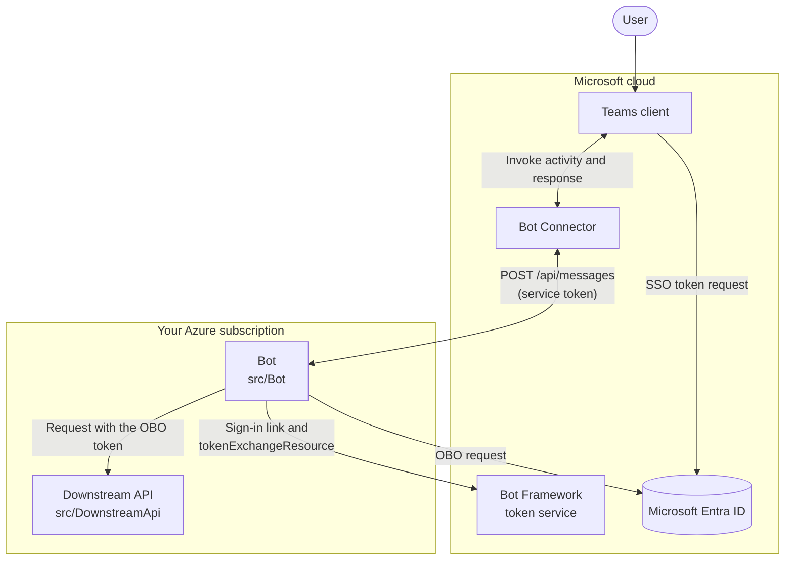
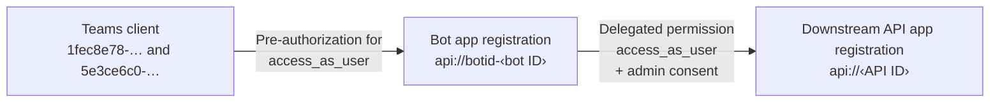
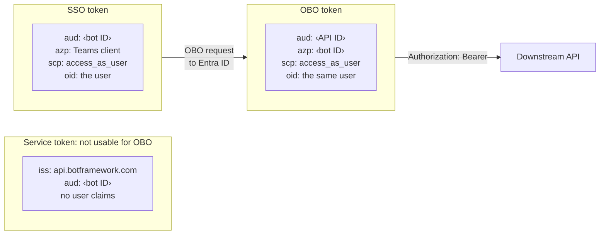
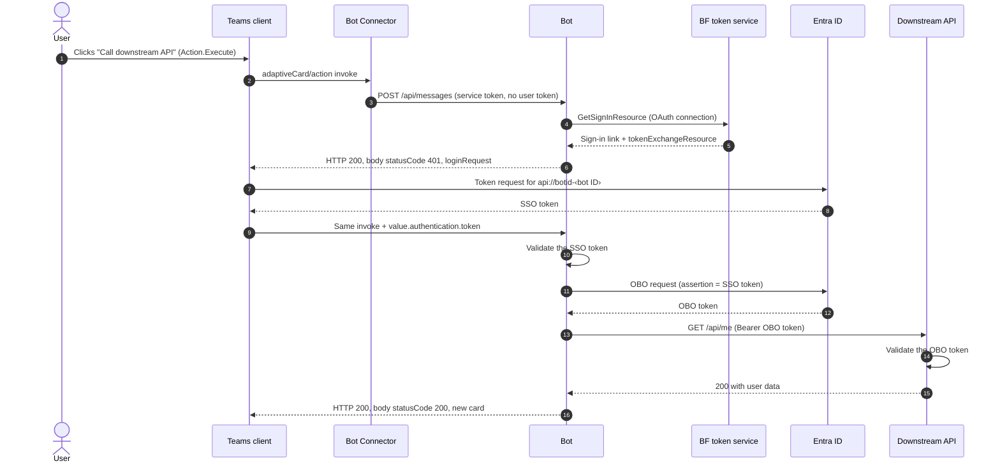
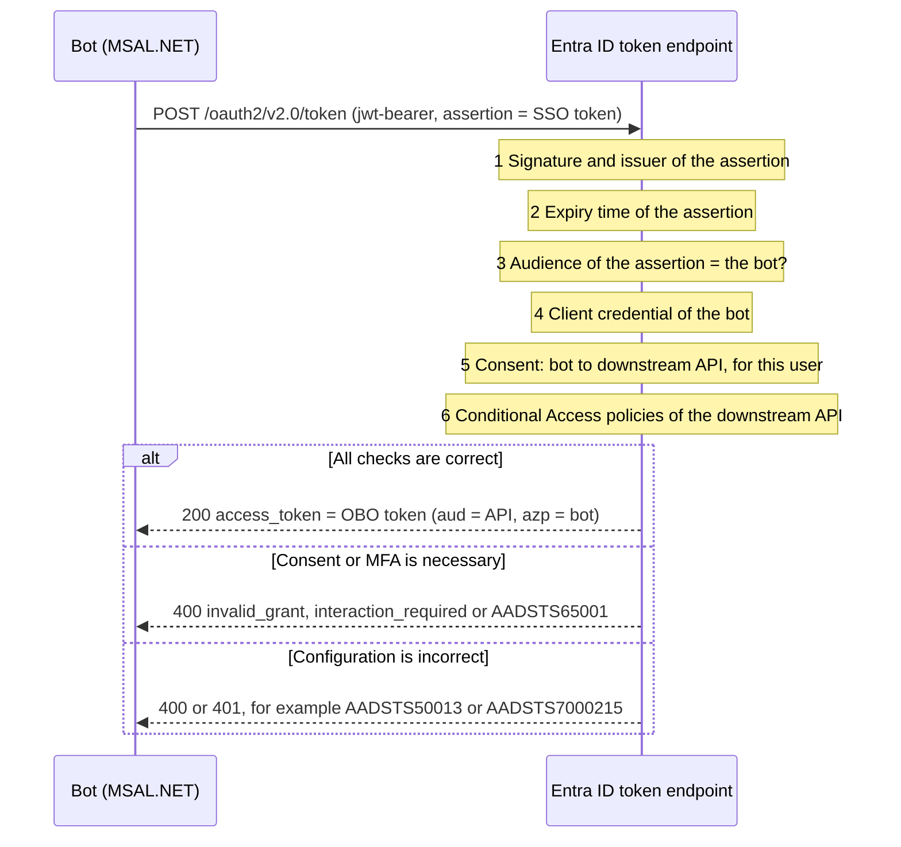
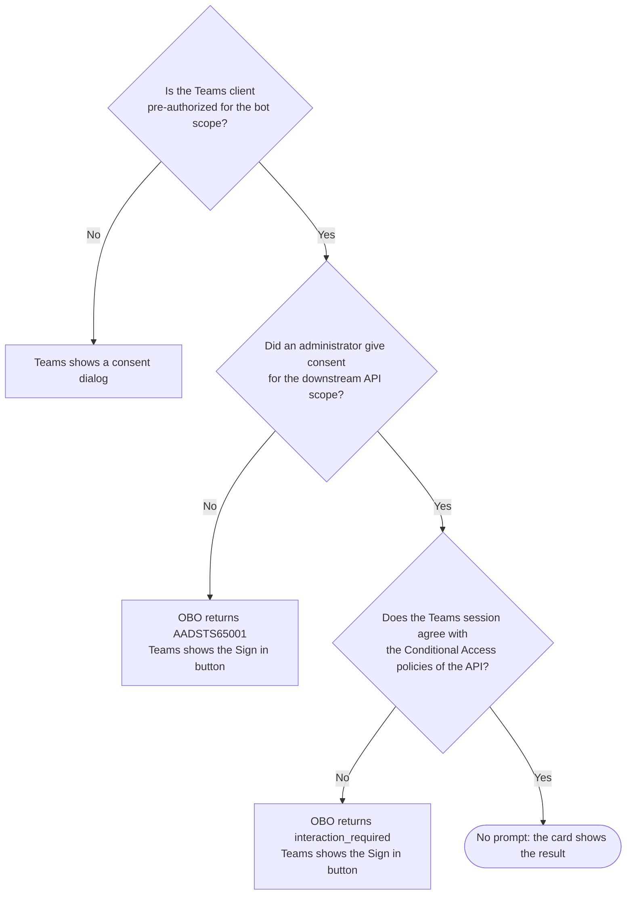
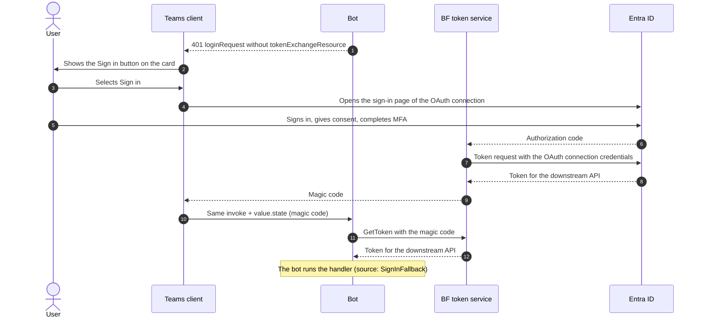
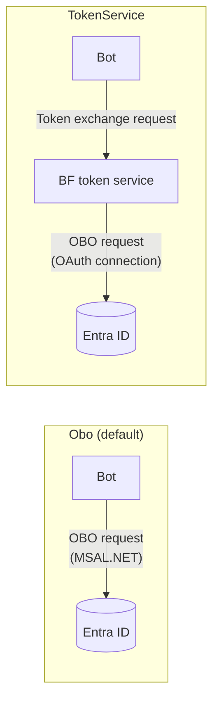

# How the on-behalf-of (OBO) flow works

This document uses ASD-STE100 Simplified Technical English. Section 15 gives the rules that it applies.

## 1 Purpose

This document tells you how the bot gets a token for the downstream API. The token is for the user who clicks the card button. The user does not see a sign-in window or an MFA prompt.

Read this document before you change the code in `src/Bot/Sso/`.

## 2 Summary

The bot cannot get a user token directly from Microsoft Entra ID. Only the Teams client has a session for the user. The flow has two parts:

1. The bot asks the Teams client for a token. The Teams client gets this token from Entra ID without a prompt. This token is the SSO token. The SSO token is for the bot only.
2. The bot sends the SSO token to Entra ID and asks for a token for the downstream API. This step is the on-behalf-of (OBO) flow. Entra ID returns the OBO token.

The OBO token is for the downstream API. It identifies the same user as the SSO token. The bot sends the OBO token to the downstream API in the `Authorization` header.


## 3 Terms

| Term | Description |
| --- | --- |
| Access token | A JSON Web Token (JWT) that Entra ID signs. An API accepts the token as the identity of the caller and the user. |
| Audience (`aud` claim) | The API that the token is for. An API must reject a token that has a different audience. |
| Scope (`scp` claim) | The delegated permission in the token, for example `access_as_user`. Only a user token has this claim. |
| Authorized party (`azp` claim, `appid` in v1 tokens) | The app that asked Entra ID for the token. |
| Object ID (`oid` claim) | The ID of the user in Entra ID. |
| SSO token | The access token that the Teams client gets for the bot. The audience is the bot. The authorized party is the Teams client. |
| OBO token | The access token that the bot gets for the downstream API. The audience is the downstream API. The authorized party is the bot. |
| Service token | The token in the `Authorization` header of each request from the Bot Connector to the bot. It identifies the Bot Connector. It does not identify the user. |
| Assertion | The token that the bot sends in the OBO request. In this flow, the assertion is the SSO token. |
| Pre-authorization | A setting in the bot app registration. It lets the Teams client get the SSO token without a consent prompt. |
| Admin consent | A permission that an administrator gives for all users in the tenant. It lets the bot get the OBO token without a consent prompt. |
| OAuth connection | A setting on the Azure Bot resource. The Bot Framework token service uses it for the sign-in link and for the token exchange. |
| Magic code | A one-time code. The Teams client sends it to the bot after the user signs in with the Sign in button. |

## 4 Parts of the system

Seven parts take part in the flow. Microsoft operates the Teams client, the Bot Connector, the Bot Framework token service and Entra ID. You operate the bot and the downstream API.



Three app identities take part in the flow:

| App | Client ID | Function in the flow |
| --- | --- | --- |
| Teams client | `1fec8e78-bce4-4aaf-ab1b-5451cc387264` (desktop and mobile), `5e3ce6c0-2b1f-4285-8d4b-75ee78787346` (web) | Microsoft owns these apps. The Teams client asks Entra ID for the SSO token. |
| Bot app registration | Your bot ID | It exposes the scope `api://botid-<bot ID>/access_as_user`. The bot uses its client secret to ask for the OBO token. |
| Downstream API app registration | Your API ID | It exposes the scope `api://<API ID>/access_as_user`. The downstream API accepts the OBO token. |

Two permissions connect the three apps. Each permission removes one consent prompt.



## 5 The three tokens

Each request from the Bot Connector to the bot has a service token. This token identifies the Bot Connector. It does not identify the user, and it has no `scp` claim. Entra ID rejects it as an OBO assertion.

The user name in a request comes from `activity.from`. This field is not a token. The bot cannot use it to get a token.

The bot must get the SSO token from the Teams client. Then the bot uses the SSO token to get the OBO token.



| Claim | Service token | SSO token | OBO token |
| --- | --- | --- | --- |
| `iss` | `https://api.botframework.com` | Entra ID, your tenant | Entra ID, your tenant |
| `aud` | Bot ID | Bot ID (v2) or `api://botid-<bot ID>` (v1) | API ID (v2) or `api://<API ID>` (v1) |
| `azp` or `appid` | None | Teams client ID | Bot ID |
| `scp` | None | `access_as_user` | `access_as_user` |
| `oid`, `tid`, `name` | None | The user | The same user |
| Sender and receiver | Bot Connector to bot | Teams client to bot | Bot to downstream API |

CAUTION: Do not send the SSO token to the downstream API. The audience of the SSO token is the bot, so the API must reject it.

## 6 The full sequence

This sequence shows the silent path. The user clicks once and sees the result. Steps 4 to 9 occur without a prompt.



| Step | Description | Code |
| --- | --- | --- |
| 1 | The user clicks the `Action.Execute` button on the card. | `Cards.Welcome` |
| 2 to 3 | Teams sends an `adaptiveCard/action` invoke activity. The Bot Connector sends it to the bot with a service token. The Teams SDK validates the service token. | `Program.cs`, `OnAdaptiveCardAction` |
| 4 to 5 | The bot asks the token service for the sign-in resource of the OAuth connection. The response has a sign-in link and a `tokenExchangeResource`. | `TokenServiceClient.GetSignInResourceAsync` |
| 6 | The bot replies with a `loginRequest`. The HTTP status is 200. The body has `statusCode` 401 and the `tokenExchangeResource`. The Bot Connector sends the reply to the Teams client. | `CardActionSso`, `CardActionResponses.LoginRequest` |
| 7 to 8 | The Teams client asks Entra ID for a token for `api://botid-<bot ID>`. It uses the current session of the user. Entra ID returns the SSO token. | Teams client |
| 9 | The Teams client sends the same invoke activity again, through the Bot Connector. The SSO token is in `value.authentication.token`. | `CardActionTurn.FromContext` |
| 10 | The bot validates the SSO token. Section 12 gives the checks. | `SsoTokenValidator` |
| 11 to 12 | The bot sends the OBO request to Entra ID. Entra ID returns the OBO token. Section 7 gives the details. | `OboTokenStrategy`, `MsalOboTokenAcquirer` |
| 13 to 15 | The bot sends a request to the downstream API with the OBO token. The API validates the token and returns the user data. | `DownstreamApiClient`, `src/DownstreamApi/Program.cs` |
| 16 | The bot returns a new card. The HTTP status is 200, and the body has `statusCode` 200. | `Cards.Result` |

NOTE: The bot does steps 4 to 9 on each click when `Sso:TokenStrategy` is `Obo`. Steps 7 and 8 usually do not go to Entra ID. The Teams client has the SSO token in its cache.

## 7 The OBO request

The bot uses MSAL.NET for the OBO request. MSAL.NET sends this HTTP request to the token endpoint of Entra ID:

```http
POST https://login.microsoftonline.com/{tenant-id}/oauth2/v2.0/token
Content-Type: application/x-www-form-urlencoded

grant_type=urn:ietf:params:oauth:grant-type:jwt-bearer
&requested_token_use=on_behalf_of
&client_id={bot-id}
&client_secret={bot-secret}
&assertion={SSO token}
&scope=api://{api-id}/access_as_user
```

| Field | Value | Function |
| --- | --- | --- |
| `grant_type` | `urn:ietf:params:oauth:grant-type:jwt-bearer` | Identifies the request as a JWT bearer grant. |
| `requested_token_use` | `on_behalf_of` | Tells Entra ID to use the OBO flow. |
| `client_id`, `client_secret` | The bot app registration | Identifies the bot. The bot can use a certificate or a managed identity instead of a secret. |
| `assertion` | The SSO token | Identifies the user. |
| `scope` | `api://<API ID>/access_as_user` | Identifies the downstream API and the delegated permission. |

Entra ID examines the request before it returns a token:



1. Entra ID examines the signature and the issuer of the assertion. Entra ID must be the issuer.
2. Entra ID examines the expiry time of the assertion. If the expiry time is in the past, Entra ID returns `AADSTS500133`.
3. Entra ID examines the audience of the assertion. The audience must be the app that sends the request. If it is not, Entra ID returns `AADSTS50013`.
4. Entra ID examines the client credential of the bot. If the secret is incorrect, Entra ID returns `AADSTS7000215`.
5. Entra ID examines the consent for the bot to use the downstream API for this user. If there is no consent, Entra ID returns `AADSTS65001`.
6. Entra ID applies the Conditional Access policies of the downstream API. A policy can ask for a control that the user session does not have, for example MFA. Then Entra ID returns `interaction_required` and a claims challenge.

The OBO token has the same user claims as the SSO token: `oid`, `tid` and `name`. Entra ID also keeps the authentication details of the user session, for example MFA.

This code in `src/Bot/Sso/DownstreamTokenStrategies.cs` sends the request:

```csharp
var result = await _msal.AcquireTokenOnBehalfOf(scopes, new UserAssertion(assertion))
    .ExecuteAsync(cancellationToken);
return result.AccessToken;
```

MSAL.NET keeps the OBO token in a memory cache. The cache key is a hash of the assertion. If the Teams client sends the same SSO token again, MSAL.NET returns the cached OBO token. It does not send a new request to Entra ID.

## 8 Why the user sees no prompt

The flow has three places where a prompt can occur. Each place has a condition that removes the prompt.



Make sure that these conditions are true:

1. The bot app registration exposes the scope `access_as_user` at the Application ID URI `api://botid-<bot ID>`.
2. The Teams client IDs `1fec8e78-bce4-4aaf-ab1b-5451cc387264` and `5e3ce6c0-2b1f-4285-8d4b-75ee78787346` have pre-authorization for this scope.
3. In the Teams manifest, `webApplicationInfo.id` is the bot ID and `webApplicationInfo.resource` is the Application ID URI.
4. The bot app registration has the delegated permission `access_as_user` of the downstream API.
5. An administrator gave admin consent for the bot app registration.
6. The Token Exchange URL of the OAuth connection is the Application ID URI.
7. The user installed the app in the personal scope.

The Teams client gets the SSO token with the current session of the user. If the user did MFA to sign in to Teams, the session has this MFA. Entra ID keeps it in the OBO flow, so the OBO flow does not ask for MFA again.

## 9 Decision logic in the bot

`CardActionSso.HandleAsync` examines each invoke activity in this sequence:


All responses use HTTP status 200. The Teams client reads the `statusCode` in the response body.

## 10 The fallback path

If Entra ID cannot give the OBO token without an action from the user, the bot sends a different reply. It is a `loginRequest` without a `tokenExchangeResource`. Then Teams shows a Sign in button on the card. The user sees this button only one time. After the user signs in, the consent and the MFA status are in place for the next clicks.



The Scopes setting of the OAuth connection must be the scope of the downstream API. Then the sign-in gives consent for the downstream API. It also gives a token that the bot can send to the API directly.

## 11 Failure conditions

| Condition | Bot response | Result in Teams |
| --- | --- | --- |
| The SSO token is not valid: signature, issuer, audience, expiry, tenant, scope or user | 412 `preconditionFailed` | Sign in button |
| There is no consent for the downstream API (`AADSTS65001`) | 401 `loginRequest` without `tokenExchangeResource` | Sign in button |
| A Conditional Access policy asks for MFA (`AADSTS50076`, `interaction_required`) | 401 `loginRequest` without `tokenExchangeResource` | Sign in button |
| The configuration is incorrect (`AADSTS7000215`, `AADSTS70011`, `AADSTS50013`) | 200 with an error card | Error card with the AADSTS code, if `Sso:ShowDiagnostics` is `true` |
| The magic code is not correct or is too old | 401 `loginRequest` without `tokenExchangeResource` | Sign in button |
| The downstream API rejects the OBO token (401 or 403) | 200 with an error card | Error card |
| The card action has an unknown verb | 400 error | Teams error message |

## 12 Security controls

1. The Teams SDK validates the service token on each request to `/api/messages`. Only the Bot Connector can send activities to the bot.
2. The bot validates the SSO token before it uses the token. It examines the signature, the issuer, the audience, the expiry, the tenant and the scope.
3. The bot makes sure that the `oid` claim of the SSO token is the same as `activity.from.aadObjectId`. This check prevents the use of a token in the activity of a different user.
4. If Entra ID changes its signing keys, the bot gets the new keys one time and validates the token again.
5. The downstream API accepts only tokens for its own audience. It rejects the SSO token. It also rejects app-only tokens, because they have no `scp` claim.
6. The bot keeps tokens in memory only. It does not write tokens to the logs or to the cards.

WARNING: Do not set the log level of `Microsoft.Teams` to `Trace` in a shared or production environment. At this level, the Teams SDK writes each invoke activity to the log. The SSO token is in the invoke activity.

CAUTION: Do not use a client secret in production. Use a certificate or a managed identity with a federated credential. A secret can leak, and it expires.

## 13 The two strategies

The setting `Sso:TokenStrategy` selects which component sends the OBO request to Entra ID.



| Item | `Obo` | `TokenService` |
| --- | --- | --- |
| Component that sends the OBO request | The bot, with MSAL.NET | The Bot Framework token service, with the client ID, secret and scopes of the OAuth connection |
| Token storage | MSAL.NET memory cache only. Each click starts the SSO steps again. | The token service keeps the token and refreshes it. Later clicks do not start the SSO steps. |
| Number of downstream APIs | Many. The bot can use one SSO token for many APIs. | One API for each OAuth connection |
| Conditional Access claims challenge | The code gets it in `InteractionRequiredException.Claims` | The token service does not give it to the code |

## 14 Code map

| Function | File |
| --- | --- |
| Routes the invoke activity to the SSO logic | `src/Bot/Program.cs` |
| Reads the invoke value and `value.authentication` | `src/Bot/Sso/CardActionTurn.cs` |
| Runs the decision logic of section 9 | `src/Bot/Sso/CardActionSso.cs` |
| Builds the `loginRequest`, 412, card and error responses | `src/Bot/Sso/CardActionResponses.cs` |
| Validates the SSO token | `src/Bot/Sso/SsoTokenValidator.cs` |
| Sends the OBO request, or uses the token service | `src/Bot/Sso/DownstreamTokenStrategies.cs` |
| Calls the Bot Framework token service | `src/Bot/Sso/TokenServiceClient.cs` |
| Validates the OBO token in the downstream API | `src/DownstreamApi/Program.cs` |
| Tests each step with a test tenant | `test/Bot.Tests/EndToEndTests.cs` |

## 15 Writing standard

This document uses the rules of ASD-STE100 Simplified Technical English:

- Each sentence has one topic. Descriptive sentences have 25 words or fewer. Instructions have 20 words or fewer.
- Each paragraph has six sentences or fewer.
- Verbs are in the active voice and in a simple tense. Instructions use the imperative.
- Warnings and cautions start with a command, then give the reason.
- The document uses technical names and technical verbs from Microsoft Teams, Microsoft Entra ID, OAuth 2.0 and .NET. Examples are "token", "scope", "consent", "validate" and "sign in". These words are technical names or technical verbs.

A full check against the STE dictionary is still necessary.

## 16 References

- [Microsoft identity platform and OAuth 2.0 On-Behalf-Of flow](https://learn.microsoft.com/entra/identity-platform/v2-oauth2-on-behalf-of-flow)
- [Access token claims reference](https://learn.microsoft.com/entra/identity-platform/access-token-claims-reference)
- [Enable SSO for Adaptive Cards Universal Actions](https://learn.microsoft.com/microsoftteams/platform/task-modules-and-cards/cards/universal-actions-for-adaptive-cards/enable-sso-for-your-adaptive-cards-universal-action)
- [Add code to enable SSO for Adaptive Cards Universal Actions](https://learn.microsoft.com/microsoftteams/platform/task-modules-and-cards/cards/universal-actions-for-adaptive-cards/sso-adaptive-cards-universal-action)
- [Configure your bot app in Microsoft Entra ID](https://learn.microsoft.com/microsoftteams/platform/bots/how-to/authentication/bot-sso-register-aad)
